# Design Class Diagram

## Metadata
| Key | Value |
| --- | --- |
| ID | DCD-001 |
| CrossReference | [DM-001], [OC-001], [OC-002], [OC-003], [SSD-001], [SSD-002], [SSD-003], [SSD-004], [SSD-005], [DICT-001], [ADR-0002], [ADR-0005], [ADR-0006] |

## Version History
| Date | Status | Author | Reviewer | Change | Commit |
| --- | --- | --- | --- | --- | --- |
| 2026-10-15 | Deprecated | Jens Tirsvad Nielsen | AI as stand-in for S02 | Revision 4: ServerPowerPort, OperationStore, Operation, ControlServerPower, TrackOperation (MIL-004) Accepted after RC-062 | [f91e283] |
| 2026-10-16 | Proposed | Jens Tirsvad Nielsen | AI as stand-in for S02 | Revision 5: aligned with the built power code (MIL-004 task 12) | pending |

---

## Purpose and Scope

The design classes that realise the system operations of [SSD-001], [SSD-002] and
[SSD-003] and the contract of [OC-001], arranged in the layers of the clean
architecture: `domain`, `application`, `infrastructure` and `presentation`. Names are the
IT terms of [DICT-001], in the language-neutral spelling; each language applies its own
naming convention. Dependencies point inward: `application` depends on `domain`;
`infrastructure` and `presentation` depend on `application` and `domain`.

Revised for MIL-004 on 2026-10-15: `ServerPowerPort` and `OperationStore`, the `Operation` record and
the use cases `ControlServerPower` and `TrackOperation` ([ADR-0006]).

Revised again after the code of MIL-004 on 2026-10-16 (revision 5): `operationState` returns the
`Operation`; `finishedAt`, `providerReference` and `detail` are optional; `previewPowerAction`,
the result types `Confirmation`, `OperationSummary` and `PowerActionResult`, and the `pollInterval`
option were added; `TrackOperation` also depends on `ConfigurationStore`.

Revised again on 2026-10-15 for MIL-003: `Credentials` holds named values, `ProviderKind`
declares the credential names it needs and `ContaboProvider` is a second adapter
([ADR-0005]).

Revised on 2026-10-15 after the implementation of MIL-002: the provider resolver, the
result types, the credential source and the timestamp type were added; `getServer` and
`listServers` accept a configuration identifier or display name.

## Diagram

```plantuml
@startuml
hide empty members
package domain {
  enum ProviderKind {
    PROXMOX_VE
    CONTABO
  }
  class ProviderConfiguration {
    - configurationId : ConfigurationId
    - providerKind : ProviderKind
    - displayName : Text
    - address : Url
    - credentialReference : CredentialReference
  }
  class CredentialReference {
    - name : Text
    - storeKind : Text
  }
  class Credentials {
    - values : Map
  }
  class AccessResult {
    - succeeded : Boolean
    - reason : Text
  }
  class Capability {
    - name : Text
  }
  class ServerOption {
    - kind : Text
    - value : Text
  }
  class Server {
    - serverIdentifier : Text
    - name : Text
    - state : Text
    - size : Text
    - addresses : List
    - managed : Boolean
  }
  enum PowerAction {
    START
    SHUTDOWN
    STOP
    RESTART
  }
  enum OperationState {
    RUNNING
    SUCCEEDED
    FAILED
    UNKNOWN
  }
  class Operation {
    - operationId : OperationId
    - configurationId : ConfigurationId
    - serverIdentifier : Text
    - action : PowerAction
    - state : OperationState
    - startedAt : Timestamp
    - finishedAt : Timestamp [0..1]
    - providerReference : Text [0..1]
    - detail : Text [0..1]
  }
  class ManagedServerRecord {
    - configurationId : ConfigurationId
    - serverIdentifier : Text
    - recordedAt : Timestamp
  }
}
package application {
  interface ProviderPort {
    + validateAccess(address, credentials) : AccessResult
    + discoverCapabilities(configuration) : List
    + listServerOptions(configuration, optionKind) : List
    + listServers(configuration) : List
    + getServer(configuration, serverIdentifier) : Server
  }
  interface ServerPowerPort {
    + requestPower(configuration, serverIdentifier, action) : Operation
    + operationState(configuration, operation) : Operation
  }
  interface OperationStore {
    + save(operation) : void
    + load(operationId) : Operation
  }
  interface ConfigurationStore {
    + save(configuration) : void
    + loadAll() : List
    + managedServers(configurationId) : List
  }
  interface CredentialStore {
    + put(reference, credentials) : void
    + get(reference) : Credentials
  }
  interface CredentialPrompt {
    + ask(providerKind) : Credentials
  }
  interface ProviderResolver {
    + providerFor(configuration) : ProviderPort
    + powerFor(configuration) : ServerPowerPort
  }
  class ControlServerPower {
    + previewPowerAction(configuration, serverIdentifier, action) : PowerActionResult
    + requestPowerAction(configuration, serverIdentifier, action, confirmation) : PowerActionResult
  }
  class TrackOperation {
    + followOperation(operationId, timeLimit, pollInterval) : OperationSummary
    + showOperation(operationId) : OperationSummary
  }
  class AccessCheck
  class SavedConfiguration
  class CapabilityReport
  class ServerSummary
  class ServerListing
  class ProviderFailure
  class ConfigureProviderAccess {
    + validateAccess(providerKind, address, credentials) : AccessCheck
    + saveProviderConfiguration(providerKind, address, displayName, cacheCredential) : SavedConfiguration
  }
  class DiscoverCapabilities {
    + discoverCapabilities(configuration) : CapabilityReport
    + listServerOptions(configuration, optionKind) : List
  }
  class ListServers {
    + listServers(configuration) : ServerListing
    + inspectServer(configuration, serverIdentifier) : ServerSummary
  }
}
package infrastructure {
  class ProxmoxProvider
  class ContaboProvider
  class JsonLinesConfigurationStore
  class PlatformCredentialStore
  class ConsoleCredentialPrompt
}
package presentation {
  class CliApplication
  class CliProviderResolver
  class CredentialSource
}

ProviderConfiguration "0..*" --> "1" ProviderKind
ProviderConfiguration "0..*" --> "0..1" CredentialReference
ManagedServerRecord "0..*" --> "1" ProviderConfiguration
ConfigureProviderAccess ..> ProviderPort
ConfigureProviderAccess ..> ConfigurationStore
ConfigureProviderAccess ..> CredentialStore
DiscoverCapabilities ..> ProviderResolver
DiscoverCapabilities ..> ConfigurationStore
ListServers ..> ProviderResolver
ProviderResolver ..> ProviderPort
ListServers ..> ConfigurationStore
ProxmoxProvider ..|> ProviderPort
ContaboProvider ..|> ProviderPort
ProxmoxProvider ..|> ServerPowerPort
ContaboProvider ..|> ServerPowerPort
ControlServerPower ..> ProviderResolver
ControlServerPower ..> OperationStore
ControlServerPower ..> ConfigurationStore
TrackOperation ..> ProviderResolver
TrackOperation ..> OperationStore
TrackOperation ..> ConfigurationStore
Operation "0..*" --> "1" PowerAction
Operation "0..*" --> "1" OperationState
JsonLinesConfigurationStore ..|> ConfigurationStore
PlatformCredentialStore ..|> CredentialStore
ConsoleCredentialPrompt ..|> CredentialPrompt
CliApplication ..> ConfigureProviderAccess
CliApplication ..> DiscoverCapabilities
CliApplication ..> ListServers
CliApplication ..> CredentialPrompt
CliProviderResolver ..|> ProviderResolver
CliApplication ..> CredentialSource
CredentialSource ..> CredentialStore
CredentialSource ..> CredentialPrompt
@enduml
```

## Class Table

| Class | Refines (Domain Model concept) | Responsibility | Attributes | Operations |
| --- | --- | --- | --- | --- |
| ProviderKind | Provider | Names the provider a configuration connects to and the credential names it needs (`token` for Proxmox VE; `client_id`, `client_secret`, `api_user`, `api_password` for Contabo). | PROXMOX_VE, CONTABO, credentialNames | none |
| ProviderConfiguration | Provider configuration | Holds the saved settings for one provider connection. | configurationId, providerKind, displayName, address, credentialReference | none |
| CredentialReference | Credential reference | Names a secret kept by the platform. | name, storeKind | none |
| Credentials | Credential reference | Carries the named secret values of one provider for the duration of a run; hidden in every representation and never persisted ([ADR-0005]). | values | none |
| AccessResult | Access check | Carries the outcome of an access check. | succeeded, reason | none |
| Capability | Capability | Names one supported action or option. | name | none |
| ServerOption | Server option | One choice offered by a provider. | kind, value | none |
| Server | Server | Describes a server and whether this client manages it. | serverIdentifier, name, state, size, addresses, managed | none |
| ManagedServerRecord | Managed server | Records that this client manages a server. | configurationId, serverIdentifier, recordedAt | none |
| ProviderPort | (provider) | The boundary to a provider's interface; one adapter per provider. | none | validateAccess, discoverCapabilities, listServerOptions, listServers, getServer |
| ConfigurationStore | (configuration) | The boundary to the client's saved configuration. | none | save, loadAll, managedServers |
| CredentialStore | Credential reference | The boundary to the platform credential store. | none | put, get |
| CredentialPrompt | (credentials) | The boundary to asking the user for a secret. | none | ask |
| ProviderResolver | (provider) | Gives the provider port for one saved configuration, built with that configuration's credentials. | none | providerFor |
| AccessCheck, SavedConfiguration, CapabilityReport, ServerSummary, ServerListing, ProviderFailure, Confirmation, OperationSummary, PowerActionResult | (result types) | Data transfer objects that cross from the use cases to presentation so no domain entity does. | outcome, reason, entries, failures | none |
| PowerAction, OperationState | Operation | The four power actions and the four states of an operation. | START, SHUTDOWN, STOP, RESTART; RUNNING, SUCCEEDED, FAILED, UNKNOWN | none |
| Operation | Operation | One requested action and its recorded outcome; never holds a secret. `finishedAt`, `providerReference` and `detail` are empty until set; `detail` is bounded to 500 characters. | operationId, configurationId, serverIdentifier, action, state, startedAt, finishedAt, providerReference, detail | none |
| ServerPowerPort | (provider) | The boundary for the four power requests and for reading an operation's state; a narrow port beside ProviderPort ([ADR-0006]). | none | requestPower, operationState (one read; returns the operation updated, polling belongs to the caller) |
| OperationStore | (configuration) | The boundary to the record of operations. | none | save, load |
| ControlServerPower | Operation | Realises UC-008: checks capability, state and confirmation, sends one request and records the operation; a preview does every check but the confirmation and sends nothing. | none | previewPowerAction, requestPowerAction |
| TrackOperation | Operation | Realises UC-006: follows an operation to its end and records the outcome; reads the configuration to build the provider. | none | followOperation, showOperation |
| ConfigureProviderAccess | Provider configuration | Realises UC-001: validates access and saves a configuration; keeps the validated credentials in memory until the save or the next check, and never persists them. | none | validateAccess, saveProviderConfiguration |
| DiscoverCapabilities | Capability | Realises UC-002: discovers capabilities and options. | none | discoverCapabilities, listServerOptions |
| ListServers | Server | Realises UC-007: lists and inspects servers. | none | listServers, inspectServer |
| ProxmoxProvider | (provider) | Adapter for the Proxmox VE interface (read-only in this slice). | none | implements ProviderPort |
| ContaboProvider | (provider) | Adapter for the Contabo interface (read-only): exchanges the four credential values for a bearer token kept in memory, sends a request identifier on every call and renews the token once after a 401. | none | implements ProviderPort |
| JsonLinesConfigurationStore | (configuration) | Adapter that keeps configuration as JSON Lines without secrets. | none | implements ConfigurationStore |
| PlatformCredentialStore | Credential reference | Adapter for the operating system credential store. | none | implements CredentialStore |
| ConsoleCredentialPrompt | (credentials) | Adapter that asks for each credential name of the provider on the console. | none | implements CredentialPrompt |
| CliProviderResolver | (provider) | Builds the provider adapter for a configuration after obtaining its credentials. | none | implements ProviderResolver |
| CredentialSource | Credential reference | Obtains a secret: the credential store first, then the prompt (ADR-0003). | none | obtain |
| CliApplication | (client) | Entry point and composition root of the command-line client. | none | one command per use case operation |

## Method Traceability

| Method signature | Operation Contract / SSD message |
| --- | --- |
| ConfigureProviderAccess.validateAccess(providerKind, address, credentials) : AccessResult | `validateAccess` in [SSD-001] |
| ConfigureProviderAccess.saveProviderConfiguration(providerKind, address, displayName, cacheCredential) : ConfigurationId | `saveProviderConfiguration` in [OC-001] and [SSD-001] |
| DiscoverCapabilities.discoverCapabilities(configuration) : CapabilityReport | `discoverCapabilities` in [SSD-002]; `configuration` is an identifier or a display name |
| DiscoverCapabilities.listServerOptions(configuration, optionKind) : List | `listServerOptions` in [SSD-002] |
| ListServers.listServers(configuration) : ServerListing | `listServers` in [SSD-003]; the configuration argument is optional and filters |
| ListServers.inspectServer(configuration, serverIdentifier) : ServerSummary | `inspectServer` in [SSD-003] |
| ControlServerPower.previewPowerAction(configuration, serverIdentifier, action) : PowerActionResult | The checks of `requestPowerAction` in [OC-002] without the request; used by the client to state the action before it asks |
| ControlServerPower.requestPowerAction(configuration, serverIdentifier, action, confirmation) : PowerActionResult | `requestPowerAction` in [OC-002] and [SSD-004] |
| TrackOperation.followOperation(operationId, timeLimit, pollInterval) : OperationSummary | `followOperation` in [OC-003] and [SSD-005] |
| TrackOperation.showOperation(operationId) : OperationSummary | `showOperation` in [SSD-005] |
| ServerPowerPort.requestPower(configuration, serverIdentifier, action) | `requestPowerAction` in [OC-002] |
| ServerPowerPort.operationState(configuration, operation) | `followOperation` in [OC-003] |
| OperationStore.save(operation), load(operationId) | `requestPowerAction` in [OC-002] and `followOperation` in [OC-003] |
| ProviderResolver.providerFor(configuration) | Supporting operation of `discoverCapabilities`, `listServerOptions`, `listServers` and `inspectServer` (credentials differ per configuration) |
| ProviderPort.validateAccess(address, credentials) | `validateAccess` in [SSD-001] |
| ProviderPort.discoverCapabilities(configuration) | `discoverCapabilities` in [SSD-002] |
| ProviderPort.listServerOptions(configuration, optionKind) | `listServerOptions` in [SSD-002] |
| ProviderPort.listServers(configuration) | `listServers` in [SSD-003] |
| ProviderPort.getServer(configuration, serverIdentifier) | `inspectServer` in [SSD-003] |
| ConfigurationStore.save(configuration) | `saveProviderConfiguration` in [OC-001] |
| ConfigurationStore.loadAll(), managedServers(configurationId) | `listServers` in [SSD-003] (managed marking) and the configuration lookup of every message |
| CredentialStore.put(reference, credentials) | `saveProviderConfiguration` in [OC-001] (cacheCredential) |
| CredentialStore.get(reference) | `validateAccess` in [SSD-001] and `discoverCapabilities` in [SSD-002] (stored credentials) |
| CredentialPrompt.ask(providerKind) | `validateAccess` in [SSD-001] (credentials parameter) |

## Pattern Annotations

| Pattern | Classes | Rationale |
| --- | --- | --- |
| Ports and adapters | ProviderPort, ConfigurationStore, CredentialStore, CredentialPrompt and their adapters | Keeps the application free of provider, file and platform detail; a second provider is a new adapter ([ADR-0002]). |
| Composition root | CliApplication | The only place that names infrastructure classes. |
| Strategy | ProviderPort, ProxmoxProvider, ContaboProvider | Provider differences sit behind one interface; use cases do not test the provider kind ([ADR-0002]). |
| Interface segregation | ProviderPort, ServerPowerPort | Read-only code cannot reach a write by type; the write surface is four operations ([ADR-0006]). |
| Resolver | ProviderResolver, CliProviderResolver | The adapter takes its credentials at construction, and one run spans several configurations, so a port instance per configuration is resolved on demand. |
| Capability set | Capability, ProviderPort.discoverCapabilities | Provider differences are declared, not hidden ([ADR-0002]). |

## Dependency Check

No circular dependencies. `domain` depends on nothing; `application` depends on `domain`;
`infrastructure` implements `application` ports; `presentation` is the composition root
and may name every layer.

---

[DM-001]: ./domain-model.md
[OC-001]: ./use-cases/uc-001/oc.md
[SSD-001]: ./use-cases/uc-001/ssd.md
[SSD-002]: ./use-cases/uc-002/ssd.md
[SSD-003]: ./use-cases/uc-007/ssd.md
[DICT-001]: ./dictionary.md
[ADR-0002]: ./adr/adr-0002-provider-capability-model.md
[ADR-0005]: ./adr/adr-0005-contabo-credentials-and-token.md
[OC-002]: ./use-cases/uc-008/oc.md
[OC-003]: ./use-cases/uc-006/oc.md
[SSD-004]: ./use-cases/uc-008/ssd.md
[SSD-005]: ./use-cases/uc-006/ssd.md
[ADR-0006]: ./adr/adr-0006-power-actions-and-operation-tracking.md
[f91e283]: https://git.tirsystem.com/TirSystem/iac-node-forge/commit/f91e283c8b54844b30c133036cb74d0cf4de80e0
