# Design Class Diagram

## Metadata
| Key | Value |
| --- | --- |
| ID | DCD-001 |
| CrossReference | [DM-001], [OC-001], [OC-002], [OC-003], [SSD-001], [SSD-002], [SSD-003], [SSD-004], [SSD-005], [DICT-001], [ADR-0002], [ADR-0005], [ADR-0006], [ADR-0007], [SSD-006], [SSD-007], [OC-004], [OC-005] |

## Version History
| Date | Status | Author | Reviewer | Change | Commit |
| --- | --- | --- | --- | --- | --- |
| 2026-10-16 | Deprecated | Jens Tirsvad Nielsen | AI as stand-in for S02 | Revision 5: aligned with the built power code (MIL-004 task 12) Accepted after RC-065 | [27af875] |
| 2026-10-18 | Accepted | Jens Tirsvad Nielsen | AI as stand-in for S02 | Revision 6: ServerProvisionPort, DesiredConfigurationStore, ProvisionIntentStore, DesiredConfiguration, ProvisionIntent, DefineDesiredConfiguration, ProvisionServer (MIL-005) Accepted after RC-076 | [aa570c0] |

---

## Purpose and Scope

The design classes that realise the system operations of [SSD-001], [SSD-002] and
[SSD-003] and the contract of [OC-001], arranged in the layers of the clean
architecture: `domain`, `application`, `infrastructure` and `presentation`. Names are the
IT terms of [DICT-001], in the language-neutral spelling; each language applies its own
naming convention. Dependencies point inward: `application` depends on `domain`;
`infrastructure` and `presentation` depend on `application` and `domain`.

Revised for MIL-005 on 2026-10-18 (revision 6): the write side grows by the creation of a server
([ADR-0007]). `ServerProvisionPort` is a third narrow port beside `ProviderPort` and
`ServerPowerPort`; `DesiredConfigurationStore` and `ProvisionIntentStore` keep the desired
configurations and the intents; the use cases `DefineDesiredConfiguration` and `ProvisionServer`
realise [UC-003] and [UC-004]. The intent has its own store and is not added to `OperationStore`
because it exists before the operation (it is saved before the request), has its own key and its
own end, and an operation can be lost while the intent must survive; the two are linked by
`operationId`. A managed server is saved through a new `ConfigurationStore.saveManagedServer`,
because the file of managed servers is already read through that port and a second port for one
record type would split one file. `ProviderResolver` gains `provisionFor`; the option kinds
`product` and `template` and the capability `provision_server` are values, not classes. The
action of an `Operation` gains `PROVISION` (the type keeps the name `PowerAction`) and its
`serverIdentifier` becomes optional, because a provision operation can exist before the server
is known.

Revised for MIL-004 on 2026-10-15: `ServerPowerPort` and `OperationStore`, the `Operation` record and
the use cases `ControlServerPower` and `TrackOperation` ([ADR-0006]).

Revised again after the code of MIL-004 on 2026-10-16 (revision 5): `operationState` returns the
`Operation`; `finishedAt`, `providerReference` and `detail` are optional; `previewPowerAction`,
the result types `Confirmation`, `OperationSummary` and `PowerActionResult`, and the `pollInterval`
option were added; `TrackOperation` also depends on `ConfigurationStore`.

Revised again on 2026-10-15 for MIL-003: `Credentials` holds named values, `ProviderKind`
declares the credential names it needs and `ContaboProvider` is a second adapter
([ADR-0005]).

Revised on 2026-10-15 after the implementation of MIL-002: the provider resolver, the
result types, the credential source and the timestamp type were added; `getServer` and
`listServers` accept a configuration identifier or display name.

## Diagram

```plantuml
@startuml
hide empty members
package domain {
  enum ProviderKind {
    PROXMOX_VE
    CONTABO
  }
  class ProviderConfiguration {
    - configurationId : ConfigurationId
    - providerKind : ProviderKind
    - displayName : Text
    - address : Url
    - credentialReference : CredentialReference
  }
  class CredentialReference {
    - name : Text
    - storeKind : Text
  }
  class Credentials {
    - values : Map
  }
  class AccessResult {
    - succeeded : Boolean
    - reason : Text
  }
  class Capability {
    - name : Text
  }
  class ServerOption {
    - kind : Text
    - value : Text
  }
  class Server {
    - serverIdentifier : Text
    - name : Text
    - state : Text
    - size : Text
    - addresses : List
    - managed : Boolean
  }
  enum PowerAction {
    START
    SHUTDOWN
    STOP
    RESTART
    PROVISION
  }
  enum OperationState {
    RUNNING
    SUCCEEDED
    FAILED
    UNKNOWN
  }
  class Operation {
    - operationId : OperationId
    - configurationId : ConfigurationId
    - serverIdentifier : Text [0..1]
    - action : PowerAction
    - state : OperationState
    - startedAt : Timestamp
    - finishedAt : Timestamp [0..1]
    - providerReference : Text [0..1]
    - detail : Text [0..1]
  }
  class ManagedServerRecord {
    - configurationId : ConfigurationId
    - serverIdentifier : Text
    - recordedAt : Timestamp
  }
  class ProviderValue {
    - name : Text
    - value : Text
  }
  class DesiredConfiguration {
    - configurationId : ConfigurationId
    - desiredName : Text
    - image : Text
    - accessKeyNames : List
    - bootstrapHint : Text [0..1]
    - values : List
  }
  enum IntentState {
    PENDING
    ENDED
  }
  class ProvisionIntent {
    - intentId : IntentId
    - configurationId : ConfigurationId
    - desiredName : Text
    - serverName : Text
    - image : Text
    - values : List
    - reservedIdentifier : Text [0..1]
    - state : IntentState
    - recordedAt : Timestamp
    - operationId : OperationId [0..1]
  }
  class ValueRule {
    - name : Text
    - required : Boolean
    - optionKind : Text [0..1]
    - allowed : List
    - minimum : Integer [0..1]
    - maximum : Integer [0..1]
  }
}
package application {
  interface ProviderPort {
    + validateAccess(address, credentials) : AccessResult
    + discoverCapabilities(configuration) : List
    + listServerOptions(configuration, optionKind) : List
    + listServers(configuration) : List
    + getServer(configuration, serverIdentifier) : Server
  }
  interface ServerPowerPort {
    + requestPower(configuration, serverIdentifier, action) : Operation
    + operationState(configuration, operation) : Operation
  }
  interface ServerProvisionPort {
    + valueRules(configuration) : List
    + reserveIdentifier(configuration) : Text [0..1]
    + costConsequence(configuration, desiredConfiguration) : Text [0..1]
    + requestProvision(configuration, desiredConfiguration, serverName, reservedIdentifier) : Operation
    + operationState(configuration, operation) : Operation
  }
  interface OperationStore {
    + save(operation) : void
    + load(operationId) : Operation
  }
  interface DesiredConfigurationStore {
    + save(desiredConfiguration) : void
    + load(configurationId, desiredName) : DesiredConfiguration [0..1]
    + loadAll(configurationId) : List
  }
  interface ProvisionIntentStore {
    + save(intent) : void
    + load(intentId) : ProvisionIntent
    + findPending(configurationId, serverName) : ProvisionIntent [0..1]
    + loadByOperation(operationId) : ProvisionIntent [0..1]
  }
  interface ConfigurationStore {
    + save(configuration) : void
    + loadAll() : List
    + managedServers(configurationId) : List
    + saveManagedServer(record) : void
  }
  interface CredentialStore {
    + put(reference, credentials) : void
    + get(reference) : Credentials
  }
  interface CredentialPrompt {
    + ask(providerKind) : Credentials
  }
  interface ProviderResolver {
    + providerFor(configuration) : ProviderPort
    + powerFor(configuration) : ServerPowerPort
    + provisionFor(configuration) : ServerProvisionPort
  }
  class ControlServerPower {
    + previewPowerAction(configuration, serverIdentifier, action) : PowerActionResult
    + requestPowerAction(configuration, serverIdentifier, action, confirmation) : PowerActionResult
  }
  class TrackOperation {
    + followOperation(operationId, timeLimit, pollInterval) : OperationSummary
    + showOperation(operationId) : OperationSummary
  }
  class DesiredConfigurationValidator {
    + check(configuration, desiredConfiguration) : List
  }
  class DefineDesiredConfiguration {
    + defineDesiredConfiguration(configuration, name, image, accessKeyNames, bootstrapHint, values) : DesiredConfigurationView
    + validateDesiredConfiguration(configuration, name) : DesiredConfigurationView
    + listDesiredConfigurations(configuration) : List
  }
  class ProvisionServer {
    + previewProvisioning(configuration, desiredName, serverName) : ProvisionPreview
    + requestProvisioning(configuration, desiredName, serverName, confirmation) : ProvisionResult
    + completeProvisioning(operationId) : ProvisionResult
  }
  enum ProvisionOutcome {
    READY
    REQUESTED
    COMPLETED
    INCOMPLETE
    REJECTED
    UNSUPPORTED
    INVALID
    NAME_EXISTS
    INTENT_PENDING
    NOT_CONFIRMED
  }
  class DesiredConfigurationView
  class ProvisionPreview
  class ProvisionResult
  class AccessCheck
  class SavedConfiguration
  class CapabilityReport
  class ServerSummary
  class ServerListing
  class ProviderFailure
  class ConfigureProviderAccess {
    + validateAccess(providerKind, address, credentials) : AccessCheck
    + saveProviderConfiguration(providerKind, address, displayName, cacheCredential) : SavedConfiguration
  }
  class DiscoverCapabilities {
    + discoverCapabilities(configuration) : CapabilityReport
    + listServerOptions(configuration, optionKind) : List
  }
  class ListServers {
    + listServers(configuration) : ServerListing
    + inspectServer(configuration, serverIdentifier) : ServerSummary
  }
}
package infrastructure {
  class ProxmoxProvider
  class ContaboProvider
  class JsonLinesConfigurationStore
  class PlatformCredentialStore
  class ConsoleCredentialPrompt
}
package presentation {
  class CliApplication
  class CliProviderResolver
  class CredentialSource
}

ProviderConfiguration "0..*" --> "1" ProviderKind
ProviderConfiguration "0..*" --> "0..1" CredentialReference
ManagedServerRecord "0..*" --> "1" ProviderConfiguration
ConfigureProviderAccess ..> ProviderPort
ConfigureProviderAccess ..> ConfigurationStore
ConfigureProviderAccess ..> CredentialStore
DiscoverCapabilities ..> ProviderResolver
DiscoverCapabilities ..> ConfigurationStore
ListServers ..> ProviderResolver
ProviderResolver ..> ProviderPort
ListServers ..> ConfigurationStore
ProxmoxProvider ..|> ProviderPort
ContaboProvider ..|> ProviderPort
ProxmoxProvider ..|> ServerPowerPort
ContaboProvider ..|> ServerPowerPort
ProxmoxProvider ..|> ServerProvisionPort
ContaboProvider ..|> ServerProvisionPort
ControlServerPower ..> ProviderResolver
ServerProvisionPort ..> ValueRule
ControlServerPower ..> OperationStore
ControlServerPower ..> ConfigurationStore
TrackOperation ..> ProviderResolver
TrackOperation ..> OperationStore
TrackOperation ..> ConfigurationStore
Operation "0..*" --> "1" PowerAction
Operation "0..*" --> "1" OperationState
DesiredConfiguration "0..*" --> "1" ProviderConfiguration
DesiredConfiguration "1" *-- "0..*" ProviderValue
ProvisionIntent "1" *-- "0..*" ProviderValue
ProvisionIntent "0..*" --> "1" DesiredConfiguration
ProvisionIntent "0..*" --> "1" IntentState
ProvisionIntent "0..1" --> "0..1" Operation
DesiredConfigurationValidator ..> ProviderResolver
DefineDesiredConfiguration ..> DesiredConfigurationValidator
DefineDesiredConfiguration ..> DesiredConfigurationStore
DefineDesiredConfiguration ..> ConfigurationStore
ProvisionServer ..> DesiredConfigurationValidator
ProvisionServer ..> ProviderResolver
ProvisionServer ..> DesiredConfigurationStore
ProvisionServer ..> ProvisionIntentStore
ProvisionServer ..> OperationStore
ProvisionServer ..> ConfigurationStore
JsonLinesConfigurationStore ..|> ConfigurationStore
JsonLinesConfigurationStore ..|> OperationStore
JsonLinesConfigurationStore ..|> DesiredConfigurationStore
JsonLinesConfigurationStore ..|> ProvisionIntentStore
PlatformCredentialStore ..|> CredentialStore
ConsoleCredentialPrompt ..|> CredentialPrompt
CliApplication ..> ConfigureProviderAccess
CliApplication ..> DiscoverCapabilities
CliApplication ..> ListServers
CliApplication ..> DefineDesiredConfiguration
CliApplication ..> ProvisionServer
CliApplication ..> ControlServerPower
CliApplication ..> TrackOperation
CliApplication ..> CredentialPrompt
CliProviderResolver ..|> ProviderResolver
CliApplication ..> CredentialSource
CredentialSource ..> CredentialStore
CredentialSource ..> CredentialPrompt
@enduml
```

## Class Table

| Class | Refines (Domain Model concept) | Responsibility | Attributes | Operations |
| --- | --- | --- | --- | --- |
| ProviderKind | Provider | Names the provider a configuration connects to and the credential names it needs (`token` for Proxmox VE; `client_id`, `client_secret`, `api_user`, `api_password` for Contabo). | PROXMOX_VE, CONTABO, credentialNames | none |
| ProviderConfiguration | Provider configuration | Holds the saved settings for one provider connection. | configurationId, providerKind, displayName, address, credentialReference | none |
| CredentialReference | Credential reference | Names a secret kept by the platform. | name, storeKind | none |
| Credentials | Credential reference | Carries the named secret values of one provider for the duration of a run; hidden in every representation and never persisted ([ADR-0005]). | values | none |
| AccessResult | Access check | Carries the outcome of an access check. | succeeded, reason | none |
| Capability | Capability | Names one supported action or option, for example `list_servers`, the four power actions and `provision_server`. | name | none |
| ServerOption | Server option | One choice offered by a provider. The kinds are `node`, `storage` and `template` (Proxmox VE), `region`, `image` and `product` (Contabo) ([ADR-0002], [ADR-0007]). | kind, value | none |
| Server | Server | Describes a server and whether this client manages it. | serverIdentifier, name, state, size, addresses, managed | none |
| ManagedServerRecord | Managed server | Records that this client manages a server. | configurationId, serverIdentifier, recordedAt | none |
| ProviderValue | Provider-specific value | One named value of a desired configuration or of an intent (a node, a storage, a region, a product, a period, a size); an immutable name and value pair. | name, value | none |
| DesiredConfiguration | Desired configuration | A named, reusable description of the server wanted, unique by (configurationId, desiredName); holds the neutral core and its ProviderValues, only the names of access keys, never a key value; `bootstrapHint` is bounded to 500 characters. | configurationId, desiredName, image, accessKeyNames, bootstrapHint, values | none |
| IntentState | Provision intent | The two states of an intent: it is pending until its operation ends. | PENDING, ENDED | none |
| ProvisionIntent | Provision intent | The record saved before the create request: server name, a copy of the chosen values and, for Proxmox VE, the reserved identifier; linked to its operation by `operationId` once the request is made. Never holds a secret. | intentId, configurationId, desiredName, serverName, image, values, reservedIdentifier, state, recordedAt, operationId | none |
| ValueRule | Provider-specific value | What a provider declares about one ProviderValue: its name, whether it is required, the option kind it is checked against, or the allowed values or bounds. | name, required, optionKind, allowed, minimum, maximum | none |
| ProviderPort | (provider) | The boundary to a provider's interface; one adapter per provider. | none | validateAccess, discoverCapabilities, listServerOptions, listServers, getServer |
| ConfigurationStore | (configuration) | The boundary to the client's saved configuration, including the managed servers. | none | save, loadAll, managedServers, saveManagedServer |
| CredentialStore | Credential reference | The boundary to the platform credential store. | none | put, get |
| CredentialPrompt | (credentials) | The boundary to asking the user for a secret. | none | ask |
| ProviderResolver | (provider) | Gives the provider port, the power port and the provision port for one saved configuration, built with that configuration's credentials. | none | providerFor, powerFor, provisionFor |
| AccessCheck, SavedConfiguration, CapabilityReport, ServerSummary, ServerListing, ProviderFailure, Confirmation, OperationSummary, PowerActionResult | (result types) | Data transfer objects that cross from the use cases to presentation so no domain entity does. | outcome, reason, entries, failures | none |
| DesiredConfigurationView | Desired configuration | Result of defining, validating or listing a desired configuration: its name, configuration, image, access key names, bootstrap hint, values, whether it is valid and each problem. | configurationId, name, image, accessKeyNames, bootstrapHint, values, valid, problems | none |
| ProvisionPreview | Provision intent | What will be created: provider, configuration, desired name, server name, target, image, size, values and the cost consequence text (empty when the provider imposes none). | providerKind, configurationId, desiredName, serverName, target, image, size, values, costConsequence | none |
| ProvisionResult | Operation | Result of requesting or completing a provisioning: the outcome, the reason, the operation summary when one exists, the server identifier when known, and the state left at the provider. | outcome, reason, operation, serverIdentifier, stateLeft | none |
| ProvisionOutcome | Operation | The outcomes of a preview, a request and a completion: READY (preview offered), REQUESTED, COMPLETED (server recorded as managed), INCOMPLETE (operation unfinished, unknown or without a server identifier), REJECTED (provider refused), UNSUPPORTED, INVALID, NAME_EXISTS, INTENT_PENDING, NOT_CONFIRMED. | READY, REQUESTED, COMPLETED, INCOMPLETE, REJECTED, UNSUPPORTED, INVALID, NAME_EXISTS, INTENT_PENDING, NOT_CONFIRMED | none |
| PowerAction, OperationState | Operation | The four power actions plus PROVISION, the kind of an operation (the type keeps its name; `requestPowerAction` refuses PROVISION), and the four states of an operation. | START, SHUTDOWN, STOP, RESTART, PROVISION; RUNNING, SUCCEEDED, FAILED, UNKNOWN | none |
| Operation | Operation | One requested action and its recorded outcome; never holds a secret. `serverIdentifier`, `finishedAt`, `providerReference` and `detail` are empty until set (`serverIdentifier` for a provision operation until the provider names the server); `detail` is bounded to 500 characters. | operationId, configurationId, serverIdentifier, action, state, startedAt, finishedAt, providerReference, detail | none |
| ServerPowerPort | (provider) | The boundary for the four power requests and for reading an operation's state; a narrow port beside ProviderPort ([ADR-0006]). | none | requestPower, operationState (one read; returns the operation updated, polling belongs to the caller) |
| OperationStore | (configuration) | The boundary to the record of operations. | none | save, load |
| ServerProvisionPort | (provider) | The boundary for the creation of a server: the provider's ValueRules, the reserved identifier (Proxmox VE `nextid`; empty for Contabo), the cost consequence text, the one create request, and the state of a provision operation; a narrow third port beside ProviderPort and ServerPowerPort ([ADR-0007]). | none | valueRules, reserveIdentifier, costConsequence, requestProvision, operationState |
| DesiredConfigurationStore | (configuration) | The boundary to the saved desired configurations; `save` replaces the one with the same key. | none | save, load, loadAll |
| ProvisionIntentStore | (configuration) | The boundary to the intents, kept apart from OperationStore (see the revision note). | none | save, load, findPending, loadByOperation |
| DesiredConfigurationValidator | Desired configuration | Checks a desired configuration against the provider's ValueRules and the ServerOptions it offers now; returns each problem and nothing else, so define and provision share one rule. | none | check |
| DefineDesiredConfiguration | Desired configuration | Realises UC-003: checks and saves a named desired configuration, re-checks a saved one and lists them; saves nothing that fails the check. | none | defineDesiredConfiguration, validateDesiredConfiguration, listDesiredConfigurations |
| ProvisionServer | Provision intent | Realises UC-004: previews with the cost consequence, and on confirmation saves the intent, sends one create request and records the operation; completes by recording the managed server when the operation succeeded and ending the intent. | none | previewProvisioning, requestProvisioning, completeProvisioning |
| ControlServerPower | Operation | Realises UC-008: checks capability, state and confirmation, sends one request and records the operation; a preview does every check but the confirmation and sends nothing. | none | previewPowerAction, requestPowerAction |
| TrackOperation | Operation | Realises UC-006: follows an operation to its end and records the outcome; reads the configuration to build the provider, and uses the provision port's `operationState` for an operation whose action is PROVISION. | none | followOperation, showOperation |
| ConfigureProviderAccess | Provider configuration | Realises UC-001: validates access and saves a configuration; keeps the validated credentials in memory until the save or the next check, and never persists them. | none | validateAccess, saveProviderConfiguration |
| DiscoverCapabilities | Capability | Realises UC-002: discovers capabilities and options. | none | discoverCapabilities, listServerOptions |
| ListServers | Server | Realises UC-007: lists and inspects servers. | none | listServers, inspectServer |
| ProxmoxProvider | (provider) | Adapter for the Proxmox VE interface: the reads, the four power requests and the container and virtual machine creations. | none | implements ProviderPort, ServerPowerPort, ServerProvisionPort |
| ContaboProvider | (provider) | Adapter for the Contabo interface (the reads, the four power requests and the instance creation): exchanges the four credential values for a bearer token kept in memory, sends a request identifier on every call and renews the token once after a 401. | none | implements ProviderPort, ServerPowerPort, ServerProvisionPort |
| JsonLinesConfigurationStore | (configuration) | Adapter that keeps configuration, operations, desired configurations, intents and managed servers as JSON Lines in one file without secrets. | none | implements ConfigurationStore, OperationStore, DesiredConfigurationStore, ProvisionIntentStore |
| PlatformCredentialStore | Credential reference | Adapter for the operating system credential store. | none | implements CredentialStore |
| ConsoleCredentialPrompt | (credentials) | Adapter that asks for each credential name of the provider on the console. | none | implements CredentialPrompt |
| CliProviderResolver | (provider) | Builds the provider adapter for a configuration after obtaining its credentials. | none | implements ProviderResolver |
| CredentialSource | Credential reference | Obtains a secret: the credential store first, then the prompt (ADR-0003). | none | obtain |
| CliApplication | (client) | Entry point and composition root of the command-line client. | none | one command per use case operation |

## Method Traceability

| Method signature | Operation Contract / SSD message |
| --- | --- |
| ConfigureProviderAccess.validateAccess(providerKind, address, credentials) : AccessResult | `validateAccess` in [SSD-001] |
| ConfigureProviderAccess.saveProviderConfiguration(providerKind, address, displayName, cacheCredential) : ConfigurationId | `saveProviderConfiguration` in [OC-001] and [SSD-001] |
| DiscoverCapabilities.discoverCapabilities(configuration) : CapabilityReport | `discoverCapabilities` in [SSD-002]; `configuration` is an identifier or a display name |
| DiscoverCapabilities.listServerOptions(configuration, optionKind) : List | `listServerOptions` in [SSD-002] |
| ListServers.listServers(configuration) : ServerListing | `listServers` in [SSD-003]; the configuration argument is optional and filters |
| ListServers.inspectServer(configuration, serverIdentifier) : ServerSummary | `inspectServer` in [SSD-003] |
| ControlServerPower.previewPowerAction(configuration, serverIdentifier, action) : PowerActionResult | The checks of `requestPowerAction` in [OC-002] without the request; used by the client to state the action before it asks |
| ControlServerPower.requestPowerAction(configuration, serverIdentifier, action, confirmation) : PowerActionResult | `requestPowerAction` in [OC-002] and [SSD-004] |
| TrackOperation.followOperation(operationId, timeLimit, pollInterval) : OperationSummary | `followOperation` in [OC-003] and [SSD-005] |
| TrackOperation.showOperation(operationId) : OperationSummary | `showOperation` in [SSD-005] |
| ServerPowerPort.requestPower(configuration, serverIdentifier, action) | `requestPowerAction` in [OC-002] |
| ServerPowerPort.operationState(configuration, operation) | `followOperation` in [OC-003] |
| OperationStore.save(operation), load(operationId) | `requestPowerAction` in [OC-002] and `followOperation` in [OC-003] |
| DefineDesiredConfiguration.defineDesiredConfiguration(configuration, name, image, accessKeyNames, bootstrapHint, values) : DesiredConfigurationView | `defineDesiredConfiguration` in [OC-004] and [SSD-006] |
| DefineDesiredConfiguration.validateDesiredConfiguration(configuration, name) : DesiredConfigurationView | `validateDesiredConfiguration` in [OC-004] and [SSD-006] |
| DefineDesiredConfiguration.listDesiredConfigurations(configuration) : List | `listDesiredConfigurations` in [SSD-006] (a query; no contract) |
| DesiredConfigurationValidator.check(configuration, desiredConfiguration) : List | Supporting operation: the preconditions on the image and the values of `defineDesiredConfiguration` and `validateDesiredConfiguration` in [OC-004], and of `previewProvisioning` and `requestProvisioning` in [OC-005] |
| ProvisionServer.previewProvisioning(configuration, desiredName, serverName) : ProvisionPreview | `previewProvisioning` in [OC-005] and [SSD-007] |
| ProvisionServer.requestProvisioning(configuration, desiredName, serverName, confirmation) : ProvisionResult | `requestProvisioning` in [OC-005] and [SSD-007] |
| ProvisionServer.completeProvisioning(operationId) : ProvisionResult | `completeProvisioning` in [OC-005] and [SSD-007] |
| ServerProvisionPort.valueRules(configuration) | `defineDesiredConfiguration` in [OC-004] (the provider's required values and checks) |
| ServerProvisionPort.reserveIdentifier(configuration) | `requestProvisioning` in [OC-005] (the reserved identifier saved in the intent) |
| ServerProvisionPort.costConsequence(configuration, desiredConfiguration) | `previewProvisioning` in [OC-005] (the cost consequence) |
| ServerProvisionPort.requestProvision(configuration, desiredConfiguration, serverName, reservedIdentifier) | `requestProvisioning` in [OC-005] (the one create request) |
| ServerProvisionPort.operationState(configuration, operation) | `followOperation` in [OC-003] for an operation with action PROVISION |
| DesiredConfigurationStore.save(desiredConfiguration) | `defineDesiredConfiguration` in [OC-004] |
| DesiredConfigurationStore.load(configurationId, desiredName), loadAll(configurationId) | `validateDesiredConfiguration` in [OC-004], `listDesiredConfigurations` in [SSD-006], `previewProvisioning` and `requestProvisioning` in [OC-005] |
| ProvisionIntentStore.save(intent), load(intentId) | `requestProvisioning` and `completeProvisioning` in [OC-005] |
| ProvisionIntentStore.findPending(configurationId, serverName) | `previewProvisioning` and `requestProvisioning` in [OC-005] (the pending-intent precondition) |
| ProvisionIntentStore.loadByOperation(operationId) | `completeProvisioning` in [OC-005] |
| ConfigurationStore.saveManagedServer(record) | `completeProvisioning` in [OC-005] (the ManagedServerRecord) |
| ProviderResolver.provisionFor(configuration) | Supporting operation of `defineDesiredConfiguration`, `validateDesiredConfiguration`, `previewProvisioning`, `requestProvisioning` and `completeProvisioning` (credentials differ per configuration) |
| ProviderResolver.providerFor(configuration) | Supporting operation of `discoverCapabilities`, `listServerOptions`, `listServers` and `inspectServer` (credentials differ per configuration) |
| ProviderPort.validateAccess(address, credentials) | `validateAccess` in [SSD-001] |
| ProviderPort.discoverCapabilities(configuration) | `discoverCapabilities` in [SSD-002] |
| ProviderPort.listServerOptions(configuration, optionKind) | `listServerOptions` in [SSD-002] |
| ProviderPort.listServers(configuration) | `listServers` in [SSD-003] |
| ProviderPort.getServer(configuration, serverIdentifier) | `inspectServer` in [SSD-003] |
| ConfigurationStore.save(configuration) | `saveProviderConfiguration` in [OC-001] |
| ConfigurationStore.loadAll(), managedServers(configurationId) | `listServers` in [SSD-003] (managed marking) and the configuration lookup of every message |
| CredentialStore.put(reference, credentials) | `saveProviderConfiguration` in [OC-001] (cacheCredential) |
| CredentialStore.get(reference) | `validateAccess` in [SSD-001] and `discoverCapabilities` in [SSD-002] (stored credentials) |
| CredentialPrompt.ask(providerKind) | `validateAccess` in [SSD-001] (credentials parameter) |

## Pattern Annotations

| Pattern | Classes | Rationale |
| --- | --- | --- |
| Ports and adapters | ProviderPort, ConfigurationStore, CredentialStore, CredentialPrompt and their adapters | Keeps the application free of provider, file and platform detail; a second provider is a new adapter ([ADR-0002]). |
| Composition root | CliApplication | The only place that names infrastructure classes. |
| Strategy | ProviderPort, ProxmoxProvider, ContaboProvider | Provider differences sit behind one interface; use cases do not test the provider kind ([ADR-0002]). |
| Interface segregation | ProviderPort, ServerPowerPort, ServerProvisionPort | Read-only code cannot reach a write by type; the write surface is the four power requests ([ADR-0006]) and the create requests ([ADR-0007]). |
| Write-ahead record | ProvisionIntent, ProvisionIntentStore, ProvisionServer | The intent is saved before the create request, so a lost answer leaves a pending intent that a retry meets ([ADR-0007]). |
| Data-driven validation | ValueRule, DesiredConfigurationValidator | Each provider declares its values as data; the validator holds one rule for every provider and use cases do not test the provider kind ([ADR-0002]). |
| Resolver | ProviderResolver, CliProviderResolver | The adapter takes its credentials at construction, and one run spans several configurations, so a port instance per configuration is resolved on demand. |
| Capability set | Capability, ProviderPort.discoverCapabilities | Provider differences are declared, not hidden ([ADR-0002]). |

## Dependency Check

No circular dependencies. `domain` depends on nothing; `application` depends on `domain`;
`infrastructure` implements `application` ports; `presentation` is the composition root
and may name every layer.

---

[DM-001]: ./domain-model.md
[OC-001]: ./use-cases/uc-001/oc.md
[SSD-001]: ./use-cases/uc-001/ssd.md
[SSD-002]: ./use-cases/uc-002/ssd.md
[SSD-003]: ./use-cases/uc-007/ssd.md
[DICT-001]: ./dictionary.md
[ADR-0002]: ./adr/adr-0002-provider-capability-model.md
[ADR-0005]: ./adr/adr-0005-contabo-credentials-and-token.md
[OC-002]: ./use-cases/uc-008/oc.md
[OC-003]: ./use-cases/uc-006/oc.md
[SSD-004]: ./use-cases/uc-008/ssd.md
[SSD-005]: ./use-cases/uc-006/ssd.md
[ADR-0006]: ./adr/adr-0006-power-actions-and-operation-tracking.md
[ADR-0007]: ./adr/adr-0007-desired-configuration-and-provisioning.md
[UC-003]: ./use-cases/uc-003/uc.md
[UC-004]: ./use-cases/uc-004/uc.md
[SSD-006]: ./use-cases/uc-003/ssd.md
[SSD-007]: ./use-cases/uc-004/ssd.md
[OC-004]: ./use-cases/uc-003/oc.md
[OC-005]: ./use-cases/uc-004/oc.md
[27af875]: https://git.tirsystem.com/TirSystem/iac-node-forge/commit/27af875ccc6fb626796bf907ef68b63f967cbfdb
[aa570c0]: https://git.tirsystem.com/TirSystem/iac-node-forge/commit/aa570c0d24a2840723ff9a2db0e146999ae69381
