# Design Class Diagram

## Metadata
| Key | Value |
| --- | --- |
| ID | DCD-001 |
| CrossReference | [DM-001], [OC-001], [SSD-001], [SSD-002], [SSD-003], [DICT-001], [ADR-0002] |

## Version History
| Date | Status | Author | Reviewer | Change | Commit |
| --- | --- | --- | --- | --- | --- |
| 2026-10-15 | Proposed | Jens Tirsvad Nielsen | S02 | Initial version for the read-only slice (MIL-002) | [1f23e1f] |

---

## Purpose and Scope

The design classes that realise the system operations of [SSD-001], [SSD-002] and
[SSD-003] and the contract of [OC-001], arranged in the layers of the clean
architecture: `domain`, `application`, `infrastructure` and `presentation`. Names are the
IT terms of [DICT-001], in the language-neutral spelling; each language applies its own
naming convention. Dependencies point inward: `application` depends on `domain`;
`infrastructure` and `presentation` depend on `application` and `domain`.

## Diagram

```plantuml
@startuml
hide empty members
package domain {
  enum ProviderKind {
    PROXMOX_VE
    CONTABO
  }
  class ProviderConfiguration {
    - configurationId : ConfigurationId
    - providerKind : ProviderKind
    - displayName : Text
    - address : Url
    - credentialReference : CredentialReference
  }
  class CredentialReference {
    - name : Text
  }
  class AccessResult {
    - succeeded : Boolean
    - reason : Text
  }
  class Capability {
    - name : Text
  }
  class ServerOption {
    - kind : Text
    - value : Text
  }
  class Server {
    - serverIdentifier : Text
    - name : Text
    - state : Text
    - size : Text
    - addresses : List
    - managed : Boolean
  }
  class ManagedServerRecord {
    - configurationId : ConfigurationId
    - serverIdentifier : Text
  }
}
package application {
  interface ProviderPort {
    + validateAccess(address, credentials) : AccessResult
    + discoverCapabilities(configuration) : List
    + listServerOptions(configuration, optionKind) : List
    + listServers(configuration) : List
    + getServer(configuration, serverIdentifier) : Server
  }
  interface ConfigurationStore {
    + save(configuration) : void
    + loadAll() : List
    + managedServers(configurationId) : List
  }
  interface CredentialStore {
    + put(reference, credentials) : void
    + get(reference) : Credentials
  }
  interface CredentialPrompt {
    + ask(providerKind) : Credentials
  }
  class ConfigureProviderAccess {
    + validateAccess(providerKind, address, credentials) : AccessResult
    + saveProviderConfiguration(providerKind, address, displayName, cacheCredential) : ConfigurationId
  }
  class DiscoverCapabilities {
    + discoverCapabilities(configurationId) : List
    + listServerOptions(configurationId, optionKind) : List
  }
  class ListServers {
    + listServers() : List
    + inspectServer(configurationId, serverIdentifier) : Server
  }
}
package infrastructure {
  class ProxmoxProvider
  class JsonLinesConfigurationStore
  class PlatformCredentialStore
  class ConsoleCredentialPrompt
}
package presentation {
  class CliApplication
}

ProviderConfiguration --> ProviderKind
ProviderConfiguration --> "0..1" CredentialReference
ManagedServerRecord ..> ProviderConfiguration
ConfigureProviderAccess ..> ProviderPort
ConfigureProviderAccess ..> ConfigurationStore
ConfigureProviderAccess ..> CredentialStore
DiscoverCapabilities ..> ProviderPort
DiscoverCapabilities ..> ConfigurationStore
ListServers ..> ProviderPort
ListServers ..> ConfigurationStore
ProxmoxProvider ..|> ProviderPort
JsonLinesConfigurationStore ..|> ConfigurationStore
PlatformCredentialStore ..|> CredentialStore
ConsoleCredentialPrompt ..|> CredentialPrompt
CliApplication ..> ConfigureProviderAccess
CliApplication ..> DiscoverCapabilities
CliApplication ..> ListServers
CliApplication ..> CredentialPrompt
@enduml
```

## Class Table

| Class | Refines (Domain Model concept) | Responsibility | Attributes | Operations |
| --- | --- | --- | --- | --- |
| ProviderConfiguration | Provider configuration | Holds the saved settings for one provider connection. | configurationId, providerKind, displayName, address, credentialReference | none |
| CredentialReference | Credential reference | Names a secret kept by the platform. | name | none |
| AccessResult | Access check | Carries the outcome of an access check. | succeeded, reason | none |
| Capability | Capability | Names one supported action or option. | name | none |
| ServerOption | Server option | One choice offered by a provider. | kind, value | none |
| Server | Server | Describes a server and whether this client manages it. | serverIdentifier, name, state, size, addresses, managed | none |
| ManagedServerRecord | Managed server | Records that this client manages a server. | configurationId, serverIdentifier | none |
| ProviderPort | (provider) | The boundary to a provider's interface; one adapter per provider. | none | validateAccess, discoverCapabilities, listServerOptions, listServers, getServer |
| ConfigurationStore | (configuration) | The boundary to the client's saved configuration. | none | save, loadAll, managedServers |
| CredentialStore | Credential reference | The boundary to the platform credential store. | none | put, get |
| CredentialPrompt | (credentials) | The boundary to asking the user for a secret. | none | ask |
| ConfigureProviderAccess | Provider configuration | Realises UC-001: validates access and saves a configuration. | none | validateAccess, saveProviderConfiguration |
| DiscoverCapabilities | Capability | Realises UC-002: discovers capabilities and options. | none | discoverCapabilities, listServerOptions |
| ListServers | Server | Realises UC-007: lists and inspects servers. | none | listServers, inspectServer |
| ProxmoxProvider | (provider) | Adapter for the Proxmox VE interface (read-only in this slice). | none | implements ProviderPort |
| JsonLinesConfigurationStore | (configuration) | Adapter that keeps configuration as JSON Lines without secrets. | none | implements ConfigurationStore |
| PlatformCredentialStore | Credential reference | Adapter for the operating system credential store. | none | implements CredentialStore |
| ConsoleCredentialPrompt | (credentials) | Adapter that asks for a secret on the console. | none | implements CredentialPrompt |
| CliApplication | (client) | Entry point and composition root of the command-line client. | none | one command per use case operation |

## Method Traceability

| Method signature | Operation Contract / SSD message |
| --- | --- |
| ConfigureProviderAccess.validateAccess(providerKind, address, credentials) : AccessResult | `validateAccess` in [SSD-001] |
| ConfigureProviderAccess.saveProviderConfiguration(providerKind, address, displayName, cacheCredential) : ConfigurationId | `saveProviderConfiguration` in [OC-001] and [SSD-001] |
| DiscoverCapabilities.discoverCapabilities(configurationId) : List | `discoverCapabilities` in [SSD-002] |
| DiscoverCapabilities.listServerOptions(configurationId, optionKind) : List | `listServerOptions` in [SSD-002] |
| ListServers.listServers() : List | `listServers` in [SSD-003] |
| ListServers.inspectServer(configurationId, serverIdentifier) : Server | `inspectServer` in [SSD-003] |
| ProviderPort operations, ConfigurationStore, CredentialStore, CredentialPrompt | Supporting operations of the messages above; no message of their own |

## Pattern Annotations

| Pattern | Classes | Rationale |
| --- | --- | --- |
| Ports and adapters | ProviderPort, ConfigurationStore, CredentialStore, CredentialPrompt and their adapters | Keeps the application free of provider, file and platform detail; a second provider is a new adapter ([ADR-0002]). |
| Composition root | CliApplication | The only place that names infrastructure classes. |
| Capability set | Capability, ProviderPort.discoverCapabilities | Provider differences are declared, not hidden ([ADR-0002]). |

## Dependency Check

No circular dependencies. `domain` depends on nothing; `application` depends on `domain`;
`infrastructure` implements `application` ports; `presentation` is the composition root
and may name every layer.

---

[DM-001]: ./domain-model.md
[OC-001]: ./use-cases/uc-001/oc.md
[SSD-001]: ./use-cases/uc-001/ssd.md
[SSD-002]: ./use-cases/uc-002/ssd.md
[SSD-003]: ./use-cases/uc-007/ssd.md
[DICT-001]: ./dictionary.md
[ADR-0002]: ./adr/adr-0002-provider-capability-model.md
[1f23e1f]: https://git.tirsystem.com/TirSystem/iac-node-forge/commit/1f23e1fc3e0a468ef08a393aa5fc50c87c4148cf
