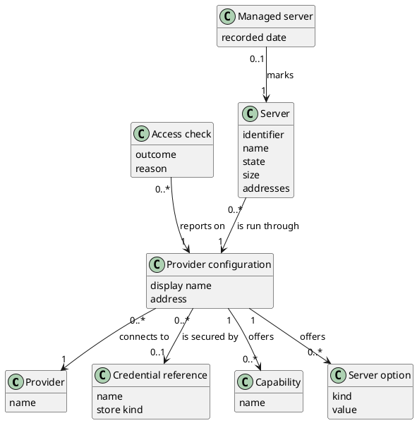

# Domain Model

## Metadata
| Key | Value |
| --- | --- |
| ID | DM-001 |
| CrossReference | [UC-001], [UC-002], [UC-007], [UCD-001], [DICT-001] |
| Language | en |
| Domain | it |

## Version History
| Date | Status | Author | Reviewer | Change | Commit |
| --- | --- | --- | --- | --- | --- |
| 2026-10-15 | Deprecated | Jens Tirsvad Nielsen | S02 | Initial version for the read-only slice (MIL-002) | [1f23e1f] |
| 2026-10-15 | Accepted | Jens Tirsvad Nielsen | AI (named by S01) | Explicit multiplicities; store kind added to Credential reference (RC-032) Accepted after RC-032 | pending |

---

## Purpose and Scope

The model covers the concepts behind configuring and validating provider access
([UC-001]), discovering capabilities and server options ([UC-002]) and listing and
inspecting servers ([UC-007]). It is the first edition; concepts for provisioning,
power control, snapshots, drift and backup are added with their use cases. Terms are
the PO terms of [DICT-001].

## Diagram

## Concept Table

| Concept | Definition | Attributes | Source |
| --- | --- | --- | --- |
| Provider | A company or platform that supplies servers. | name | [UC-001] "provider" |
| Provider configuration | Saved settings that connect this client to one provider. | display name, address | [UC-001] "provider configuration", "endpoint" |
| Credential reference | The name under which a secret is kept; never the secret. | name, store kind | [UC-001] "credentials", "credential store" |
| Access check | The outcome of validating access at the provider. | outcome, reason | [UC-001] "reports the result" |
| Capability | An action or option a provider and target support. | name | [UC-002] "capabilities", "actions the provider supports" |
| Server option | A choice offered when a server is created. | kind, value | [UC-002] "regions or nodes, images or templates, sizes or products" |
| Server | A machine that runs at a provider. | identifier, name, state, size, addresses | [UC-007] "server", "state, size and addresses" |
| Managed server | A server recorded as managed by this client. | recorded date | [UC-007] "not managed by this client" |

## Association Table

| From | Association name (reading direction) | To | Multiplicity (both ends) |
| --- | --- | --- | --- |
| Provider configuration | connects to | Provider | 0..* to 1 |
| Provider configuration | is secured by | Credential reference | 0..* to 0..1 |
| Access check | reports on | Provider configuration | 0..* to 1 |
| Provider configuration | offers | Capability | 1 to 0..* |
| Provider configuration | offers | Server option | 1 to 0..* |
| Server | is run through | Provider configuration | 0..* to 1 |
| Managed server | marks | Server | 0..1 to 1 |

## Generalizations

None.

---

[UC-001]: ./use-cases/uc-001/uc.md
[UC-002]: ./use-cases/uc-002/uc.md
[UC-007]: ./use-cases/uc-007/uc.md
[UCD-001]: ./use-case-diagram.md
[DICT-001]: ./dictionary.md
[1f23e1f]: https://git.tirsystem.com/TirSystem/iac-node-forge/commit/1f23e1fc3e0a468ef08a393aa5fc50c87c4148cf
