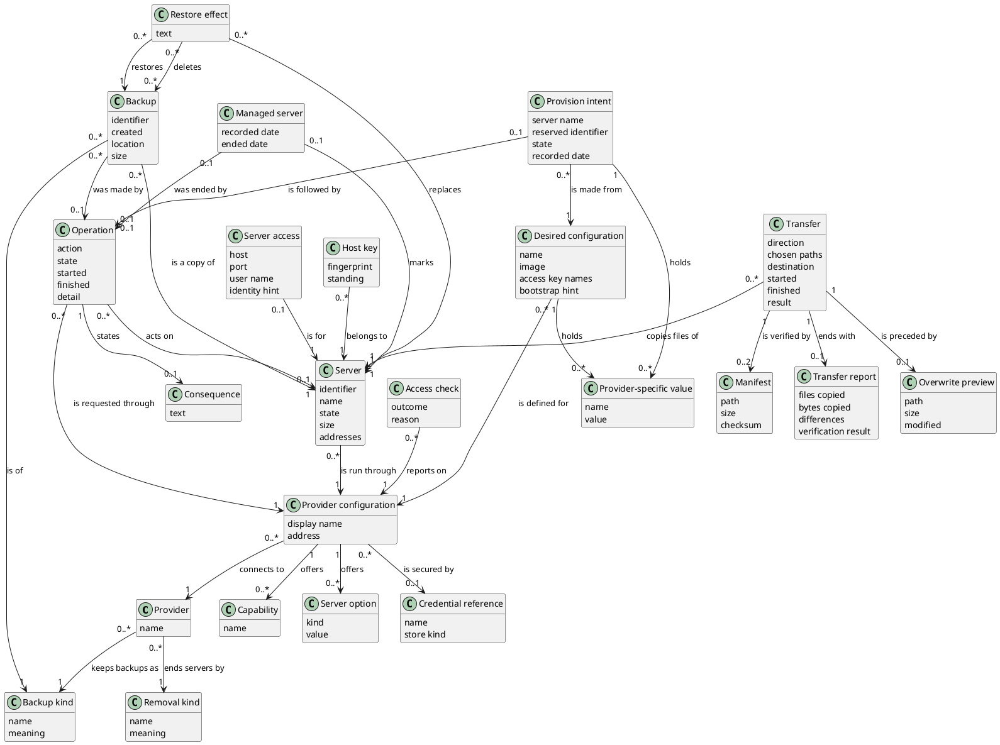

# Domain Model

## Metadata
| Key | Value |
| --- | --- |
| ID | DM-001 |
| CrossReference | [UC-001], [UC-002], [UC-003], [UC-004], [UC-006], [UC-007], [UC-008], [UC-012], [UC-016], [UC-017], [UC-018], [UC-019], [UCD-001], [DICT-001] |
| Language | en |
| Domain | it |

## Version History
| Date | Status | Author | Reviewer | Change | Commit |
| --- | --- | --- | --- | --- | --- |
| 2026-10-18 | Deprecated | Jens Tirsvad Nielsen | AI as stand-in for S02 | Added Server access, Host key, Transfer, Manifest, Transfer report and Overwrite preview (MIL-007) Accepted after RC-096 | [f05b1dd] |
| 2026-10-25 | Accepted | Jens Tirsvad Nielsen | AI as stand-in for S02 | Added Backup, Backup kind and Restore effect; Operation also covers backup and restore; Consequence also precedes a restore (MIL-008) Accepted after RC-112 | [9fd15f2] |

---

## Purpose and Scope

The model covers the concepts behind configuring and validating provider access
([UC-001]), discovering capabilities and server options ([UC-002]), listing and
inspecting servers ([UC-007]), the power actions and their operations ([UC-008], [UC-006]), the desired
configuration ([UC-003]), the provisioning of a server from it ([UC-004]) and the removal of a
server with the consequence stated first ([UC-012]), and the backup of files from a server to the local PC
([UC-016]) and their restore to a server ([UC-017]), and the backup of a whole server ([UC-018]) and its restore from
a backup ([UC-019]). Concepts for drift are added with their use cases. Terms are the PO terms of
[DICT-001].

## Diagram

## Concept Table

| Concept | Definition | Attributes | Source |
| --- | --- | --- | --- |
| Provider | A company or platform that supplies servers. | name | [UC-001] "provider" |
| Provider configuration | Saved settings that connect this client to one provider. | display name, address | [UC-001] "provider configuration", "endpoint" |
| Credential reference | The name under which a secret is kept; never the secret. | name, store kind | [UC-001] "credentials", "credential store" |
| Access check | The outcome of validating access at the provider. | outcome, reason | [UC-001] "reports the result" |
| Capability | An action or option a provider and target support. | name | [UC-002] "capabilities", "actions the provider supports" |
| Server option | A choice offered when a server is created. | kind, value | [UC-002] "regions or nodes, images or templates, sizes or products" |
| Server | A machine that runs at a provider. | identifier, name, state, size, addresses | [UC-007] "server", "state, size and addresses" |
| Managed server | A server recorded as managed by this client. It stays on record, with an ended date, after its removal, and no longer counts as managed. | recorded date, ended date | [UC-007] "not managed by this client", [UC-012] "extra confirmation if the server is not managed by this client" |
| Operation | One requested action at a provider, followed until it ends (start, shutdown, stop, restart, provision, remove, backup or restore). A provision operation may exist before the server is known. For a removal or a restore it keeps the consequence that was shown, and its detail holds the outcome: for a cancellation the effective date the provider reports, for a restore the state of the server afterwards. | action, state, started, finished, detail | [UC-006] "operation", [UC-008] "start, stop or restart", [UC-004] "submits the request to the provider, follows the operation", [UC-012] "follows it to completion", "records the consequence", [UC-018] "follows it to completion", [UC-019] "reports the state of the restored server" |
| Desired configuration | A named, reusable description of the server wanted, checked against the capabilities and options of one provider configuration before it is saved as valid. It never holds a secret; the access keys are only named. | name, image, access key names, bootstrap hint | [UC-003] "named desired configuration", "name, provider and target, size, image, access keys and bootstrap hints" |
| Provider-specific value | One named choice that only some providers need, such as a node, a storage, a region, a product or a contract period. | name, value | [UC-003] "provider and target, size", [UC-004] "contract period", "node" |
| Removal kind | The way a provider ends a server: destroyed now, or cancelled with an effective date while the contract runs on until then. | name, meaning | [UC-012] "destroyed now or cancelled with an effective date" |
| Consequence | The statement, shown before a removal or a restore is confirmed, of what the provider will do and what continues until then or is lost; it is kept with the operation. | text | [UC-012] "states what removal means at that provider", "the consequence shown to DevOps is recorded with the operation", [UC-019] "The consequence shown to DevOps is recorded with the operation" |
| Provision intent | The record, made before a creation request is sent, that a server of a given name is about to be created from a desired configuration; it keeps a retry from creating a second server. | server name, reserved identifier, state, recorded date | [UC-004] "Preventing duplicate creation on retry", "provisioning request" |
| Server access | How this client reaches the inside of one server: the host (when it is not given, the address the provider reports), the port, the user name and a hint about which identity to use. It never holds a password, a passphrase or a key. | host, port, user name, identity hint | [UC-016] "DevOps can authenticate to it", "The system connects to the server" |
| Host key | The identity that a server shows when it is reached, with its fingerprint and whether this client's user already trusts it: known, unknown or changed. An unknown one needs the user's explicit acceptance; a changed one stops the transfer. | fingerprint, standing | [UC-016] "The system connects to the server", [UC-017] "The server is running and reachable" |
| Transfer | One copy of chosen files or folders, from a server to the local PC (a backup) or from the local PC to a server (a restore), which counts as done only when it is verified complete. | direction, chosen paths, destination, started, finished, result | [UC-016] "copies the chosen data to the destination, verifies that the copy is complete", [UC-017] "copies the data to the server, verifies that the copy is complete" |
| Manifest | The list of every file in the data of a transfer with its path, size and a checksum of its content; the one made at the source is compared with the one made at the destination. | path, size, checksum | [UC-016] "verifies that the copy is complete", [UC-017] "verifies that the copy is complete" |
| Transfer report | What a transfer did: the files and bytes copied, anything skipped, the differences found by the verification, the data overwritten and the verification result; it is shown and kept. | files copied, bytes copied, differences, verification result | [UC-016] "reports what was copied", [UC-017] "reports the result", "Overwritten data is reported to DevOps before and after" |
| Overwrite preview | The statement, made before a restore is confirmed, of the existing data on the server that the restore would replace, with its size and when it was last changed. | path, size, modified | [UC-017] "states which existing data would be overwritten and asks for confirmation" |
| Backup | A copy of a whole server that exists at or through the provider, kept as an archive file on a storage or as a snapshot held by the provider, with its identifier, when it was made, where it is kept and, if known, its size. It may have been made by this client or by another tool. | identifier, created, location, size | [UC-018] "A backup of the server exists at the provider", "reports where the backup is kept", [UC-019] "A backup exists at the provider" |
| Backup kind | The way a provider keeps a backup: an archive, a file written to a storage, or a snapshot, held by the provider on the same disk system as the server and not an independent copy. | name, meaning | [UC-018] "Proxmox VE has native backup and backup storage", "a backup there may be a snapshot kept at the provider" |
| Restore effect | The statement, made before a restore is confirmed, of what the restore replaces (the server, its disks and its configuration, or its state back to the snapshot) and which other backups it deletes, with the cost where the provider states one. It is the consequence of the restore. | text | [UC-019] "states what the restore will replace and what it costs", [UC-019] "Contabo restores through snapshot rollback, which deletes newer snapshots" |

## Association Table

| From | Association name (reading direction) | To | Multiplicity (both ends) |
| --- | --- | --- | --- |
| Provider configuration | connects to | Provider | 0..* to 1 |
| Provider configuration | is secured by | Credential reference | 0..* to 0..1 |
| Access check | reports on | Provider configuration | 0..* to 1 |
| Provider configuration | offers | Capability | 1 to 0..* |
| Provider configuration | offers | Server option | 1 to 0..* |
| Server | is run through | Provider configuration | 0..* to 1 |
| Managed server | marks | Server | 0..1 to 1 |
| Operation | acts on | Server | 0..* to 0..1 |
| Operation | is requested through | Provider configuration | 0..* to 1 |
| Desired configuration | is defined for | Provider configuration | 0..* to 1 |
| Desired configuration | holds | Provider-specific value | 1 to 0..* |
| Provision intent | is made from | Desired configuration | 0..* to 1 |
| Provision intent | holds | Provider-specific value | 1 to 0..* |
| Provision intent | is followed by | Operation | 0..1 to 0..1 |
| Provider | ends servers by | Removal kind | 0..* to 1 |
| Operation | states | Consequence | 1 to 0..1 |
| Managed server | was ended by | Operation | 0..1 to 0..1 |
| Server access | is for | Server | 0..1 to 1 |
| Host key | belongs to | Server | 0..* to 1 |
| Transfer | copies files of | Server | 0..* to 1 |
| Transfer | is verified by | Manifest | 1 to 0..2 |
| Transfer | ends with | Transfer report | 1 to 0..1 |
| Transfer | is preceded by | Overwrite preview | 1 to 0..1 |
| Provider | keeps backups as | Backup kind | 0..* to 1 |
| Backup | is a copy of | Server | 0..* to 1 |
| Backup | is of | Backup kind | 0..* to 1 |
| Backup | was made by | Operation | 0..* to 0..1 |
| Restore effect | restores | Backup | 0..* to 1 |
| Restore effect | replaces | Server | 0..* to 1 |
| Restore effect | deletes | Backup | 0..* to 0..* |

## Generalizations

None.

---

[UC-001]: ./use-cases/uc-001/uc.md
[UC-002]: ./use-cases/uc-002/uc.md
[UC-003]: ./use-cases/uc-003/uc.md
[UC-004]: ./use-cases/uc-004/uc.md
[UC-006]: ./use-cases/uc-006/uc.md
[UC-007]: ./use-cases/uc-007/uc.md
[UC-008]: ./use-cases/uc-008/uc.md
[UC-012]: ./use-cases/uc-012/uc.md
[UC-016]: ./use-cases/uc-016/uc.md
[UC-017]: ./use-cases/uc-017/uc.md
[UC-018]: ./use-cases/uc-018/uc.md
[UC-019]: ./use-cases/uc-019/uc.md
[UCD-001]: ./use-case-diagram.md
[DICT-001]: ./dictionary.md
[f05b1dd]: https://git.tirsystem.com/TirSystem/iac-node-forge/commit/f05b1dd98b3282a9b01ed2875fb706e6326af769
[9fd15f2]: https://git.tirsystem.com/TirSystem/iac-node-forge/commit/9fd15f248c031b5899ed480055d33b09a2ea62fa
