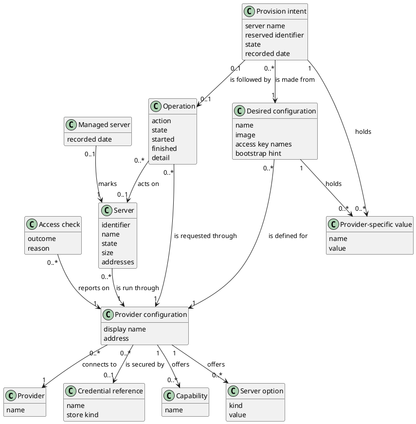

# Domain Model

## Metadata
| Key | Value |
| --- | --- |
| ID | DM-001 |
| CrossReference | [UC-001], [UC-002], [UC-003], [UC-004], [UC-006], [UC-007], [UC-008], [UCD-001], [DICT-001] |
| Language | en |
| Domain | it |

## Version History
| Date | Status | Author | Reviewer | Change | Commit |
| --- | --- | --- | --- | --- | --- |
| 2026-10-15 | Deprecated | Jens Tirsvad Nielsen | AI as stand-in for S02 | Added the Operation concept for power control (MIL-004) Accepted after RC-056 | [f91e283] |
| 2026-10-18 | Accepted | Jens Tirsvad Nielsen | AI as stand-in for S02 | Added Desired configuration, Provider-specific value and Provision intent; Operation also covers provisioning (MIL-005) Accepted after RC-070 | [aa570c0] |

---

## Purpose and Scope

The model covers the concepts behind configuring and validating provider access
([UC-001]), discovering capabilities and server options ([UC-002]), listing and
inspecting servers ([UC-007]), the power actions and their operations ([UC-008], [UC-006]), the desired
configuration ([UC-003]) and the provisioning of a server from it ([UC-004]). Concepts for
snapshots, drift and backup are added with their use cases. Terms are the PO terms of
[DICT-001].

## Diagram

## Concept Table

| Concept | Definition | Attributes | Source |
| --- | --- | --- | --- |
| Provider | A company or platform that supplies servers. | name | [UC-001] "provider" |
| Provider configuration | Saved settings that connect this client to one provider. | display name, address | [UC-001] "provider configuration", "endpoint" |
| Credential reference | The name under which a secret is kept; never the secret. | name, store kind | [UC-001] "credentials", "credential store" |
| Access check | The outcome of validating access at the provider. | outcome, reason | [UC-001] "reports the result" |
| Capability | An action or option a provider and target support. | name | [UC-002] "capabilities", "actions the provider supports" |
| Server option | A choice offered when a server is created. | kind, value | [UC-002] "regions or nodes, images or templates, sizes or products" |
| Server | A machine that runs at a provider. | identifier, name, state, size, addresses | [UC-007] "server", "state, size and addresses" |
| Managed server | A server recorded as managed by this client. | recorded date | [UC-007] "not managed by this client" |
| Operation | One requested action at a provider, followed until it ends (start, shutdown, stop, restart or provision). A provision operation may exist before the server is known. | action, state, started, finished, detail | [UC-006] "operation", [UC-008] "start, stop or restart", [UC-004] "submits the request to the provider, follows the operation" |
| Desired configuration | A named, reusable description of the server wanted, checked against the capabilities and options of one provider configuration before it is saved as valid. It never holds a secret; the access keys are only named. | name, image, access key names, bootstrap hint | [UC-003] "named desired configuration", "name, provider and target, size, image, access keys and bootstrap hints" |
| Provider-specific value | One named choice that only some providers need, such as a node, a storage, a region, a product or a contract period. | name, value | [UC-003] "provider and target, size", [UC-004] "contract period", "node" |
| Provision intent | The record, made before a creation request is sent, that a server of a given name is about to be created from a desired configuration; it keeps a retry from creating a second server. | server name, reserved identifier, state, recorded date | [UC-004] "Preventing duplicate creation on retry", "provisioning request" |

## Association Table

| From | Association name (reading direction) | To | Multiplicity (both ends) |
| --- | --- | --- | --- |
| Provider configuration | connects to | Provider | 0..* to 1 |
| Provider configuration | is secured by | Credential reference | 0..* to 0..1 |
| Access check | reports on | Provider configuration | 0..* to 1 |
| Provider configuration | offers | Capability | 1 to 0..* |
| Provider configuration | offers | Server option | 1 to 0..* |
| Server | is run through | Provider configuration | 0..* to 1 |
| Managed server | marks | Server | 0..1 to 1 |
| Operation | acts on | Server | 0..* to 0..1 |
| Operation | is requested through | Provider configuration | 0..* to 1 |
| Desired configuration | is defined for | Provider configuration | 0..* to 1 |
| Desired configuration | holds | Provider-specific value | 1 to 0..* |
| Provision intent | is made from | Desired configuration | 0..* to 1 |
| Provision intent | holds | Provider-specific value | 1 to 0..* |
| Provision intent | is followed by | Operation | 0..1 to 0..1 |

## Generalizations

None.

---

[UC-001]: ./use-cases/uc-001/uc.md
[UC-002]: ./use-cases/uc-002/uc.md
[UC-003]: ./use-cases/uc-003/uc.md
[UC-004]: ./use-cases/uc-004/uc.md
[UC-006]: ./use-cases/uc-006/uc.md
[UC-007]: ./use-cases/uc-007/uc.md
[UC-008]: ./use-cases/uc-008/uc.md
[UCD-001]: ./use-case-diagram.md
[DICT-001]: ./dictionary.md
[f91e283]: https://git.tirsystem.com/TirSystem/iac-node-forge/commit/f91e283c8b54844b30c133036cb74d0cf4de80e0
[aa570c0]: https://git.tirsystem.com/TirSystem/iac-node-forge/commit/aa570c0d24a2840723ff9a2db0e146999ae69381
