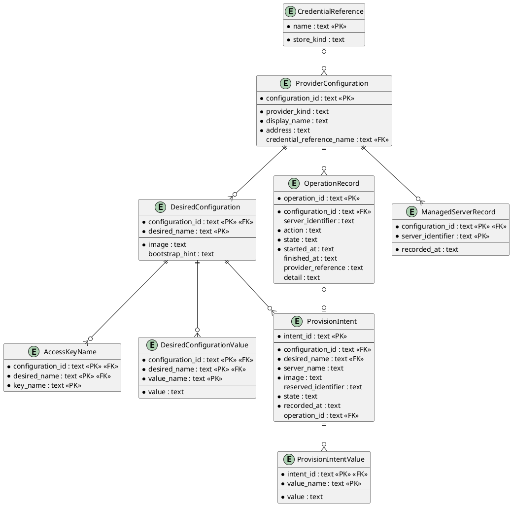

# Entity Relationship Diagram

## Metadata
| Key | Value |
| --- | --- |
| ID | ERD-001 |
| CrossReference | [DCD-001], [DICT-001], [ADR-0003], [ADR-0006], [ADR-0007] |

## Version History
| Date | Status | Author | Reviewer | Change | Commit |
| --- | --- | --- | --- | --- | --- |
| 2026-10-15 | Deprecated | Jens Tirsvad Nielsen | AI as stand-in for S02 | Added OperationRecord (MIL-004) Accepted after RC-063 | [f91e283] |
| 2026-10-18 | Accepted | Jens Tirsvad Nielsen | AI as stand-in for S02 | Added DesiredConfiguration, AccessKeyName, DesiredConfigurationValue, ProvisionIntent and ProvisionIntentValue; OperationRecord.server_identifier is nullable (MIL-005) Accepted after RC-077 | pending |

---

## Purpose and Scope

The persisted data of the command-line client in its JSON Lines (JSONL) configuration
file: provider configurations, credential references, operations, managed servers, desired
configurations with their access key names and values, and provision intents with their values.
One client has one file. One line holds one record, and a `record_type` field names the entity;
a child entity is a line of its own. There is no entity for a secret:
no record has a field that could hold one ([ADR-0003]).

## Diagram

## Entity Table

### ProviderConfiguration

| Attribute | Type | PK/FK | Nullable | Source (DCD class.attribute) |
| --- | --- | --- | --- | --- |
| configuration_id | text | PK | No | ProviderConfiguration.configurationId |
| provider_kind | text | | No | ProviderConfiguration.providerKind |
| display_name | text | | No | ProviderConfiguration.displayName |
| address | text | | No | ProviderConfiguration.address |
| credential_reference_name | text | FK | Yes | ProviderConfiguration.credentialReference |

### CredentialReference

| Attribute | Type | PK/FK | Nullable | Source (DCD class.attribute) |
| --- | --- | --- | --- | --- |
| name | text | PK | No | CredentialReference.name |
| store_kind | text | | No | CredentialReference.storeKind |

### ManagedServerRecord

| Attribute | Type | PK/FK | Nullable | Source (DCD class.attribute) |
| --- | --- | --- | --- | --- |
| configuration_id | text | PK, FK | No | ManagedServerRecord.configurationId |
| server_identifier | text | PK | No | ManagedServerRecord.serverIdentifier |
| recorded_at | text (ISO 8601 with offset) | | No | ManagedServerRecord.recordedAt (Timestamp) |

### OperationRecord

| Attribute | Type | PK/FK | Nullable | Source (DCD class.attribute) |
| --- | --- | --- | --- | --- |
| operation_id | text | PK | No | Operation.operationId |
| configuration_id | text | FK | No | Operation.configurationId |
| server_identifier | text | | Yes | Operation.serverIdentifier (empty for a provision operation until the provider names the server) |
| action | text | | No | Operation.action (PowerAction: start, shutdown, stop, restart or provision) |
| state | text | | No | Operation.state (OperationState) |
| started_at | text (ISO 8601 with offset) | | No | Operation.startedAt |
| finished_at | text (ISO 8601 with offset) | | Yes | Operation.finishedAt |
| provider_reference | text | | Yes | Operation.providerReference (a task identifier, not a secret) |
| detail | text | | Yes | Operation.detail (bounded, never a credential or header) |

### DesiredConfiguration

| Attribute | Type | PK/FK | Nullable | Source (DCD class.attribute) |
| --- | --- | --- | --- | --- |
| configuration_id | text | PK, FK | No | DesiredConfiguration.configurationId |
| desired_name | text | PK | No | DesiredConfiguration.desiredName |
| image | text | | No | DesiredConfiguration.image |
| bootstrap_hint | text (at most 500 characters) | | Yes | DesiredConfiguration.bootstrapHint |

### AccessKeyName

| Attribute | Type | PK/FK | Nullable | Source (DCD class.attribute) |
| --- | --- | --- | --- | --- |
| configuration_id | text | PK, FK | No | DesiredConfiguration.configurationId |
| desired_name | text | PK, FK | No | DesiredConfiguration.desiredName |
| key_name | text (a name, never a key value) | PK | No | DesiredConfiguration.accessKeyNames (one entry) |

### DesiredConfigurationValue

| Attribute | Type | PK/FK | Nullable | Source (DCD class.attribute) |
| --- | --- | --- | --- | --- |
| configuration_id | text | PK, FK | No | DesiredConfiguration.configurationId |
| desired_name | text | PK, FK | No | DesiredConfiguration.desiredName |
| value_name | text | PK | No | ProviderValue.name |
| value | text | | No | ProviderValue.value |

### ProvisionIntent

| Attribute | Type | PK/FK | Nullable | Source (DCD class.attribute) |
| --- | --- | --- | --- | --- |
| intent_id | text | PK | No | ProvisionIntent.intentId |
| configuration_id | text | FK | No | ProvisionIntent.configurationId |
| desired_name | text | FK | No | ProvisionIntent.desiredName |
| server_name | text | | No | ProvisionIntent.serverName |
| image | text | | No | ProvisionIntent.image (a copy at the time of the request) |
| reserved_identifier | text | | Yes | ProvisionIntent.reservedIdentifier (Proxmox VE identifier from `nextid`; empty for Contabo) |
| state | text (`pending` or `ended`) | | No | ProvisionIntent.state (IntentState) |
| recorded_at | text (ISO 8601 with offset) | | No | ProvisionIntent.recordedAt (Timestamp) |
| operation_id | text | FK | Yes | ProvisionIntent.operationId (empty until the request is made) |

### ProvisionIntentValue

| Attribute | Type | PK/FK | Nullable | Source (DCD class.attribute) |
| --- | --- | --- | --- | --- |
| intent_id | text | PK, FK | No | ProvisionIntent.intentId |
| value_name | text | PK | No | ProviderValue.name |
| value | text | | No | ProviderValue.value (a copy at the time of the request) |

## Relationship Table

| Entity | Cardinality | Entity | FK | Rule |
| --- | --- | --- | --- | --- |
| CredentialReference | 1:N (0..many) | ProviderConfiguration | credential_reference_name | A reference may be unused; a configuration has at most one. |
| ProviderConfiguration | 1:N (0..many) | OperationRecord | configuration_id | An operation belongs to the configuration it was requested through; deleting a configuration removes its records. |
| ProviderConfiguration | 1:N (0..many) | ManagedServerRecord | configuration_id | A managed server belongs to exactly one configuration; deleting a configuration removes its records. |
| ProviderConfiguration | 1:N (0..many) | DesiredConfiguration | configuration_id | A desired configuration belongs to exactly one configuration; its name is unique within it; deleting a configuration removes its records. |
| DesiredConfiguration | 1:N (0..many) | AccessKeyName | configuration_id, desired_name | The names of the access keys to install; removed with the desired configuration. |
| DesiredConfiguration | 1:N (0..many) | DesiredConfigurationValue | configuration_id, desired_name | The provider-specific values; replaced with the desired configuration. |
| DesiredConfiguration | 1:N (0..many) | ProvisionIntent | configuration_id, desired_name | An intent is made from one desired configuration; replacing the desired configuration keeps the key, so the intent stays valid. |
| ProvisionIntent | 1:N (0..many) | ProvisionIntentValue | intent_id | The values chosen at the time of the request; removed with the intent. |
| OperationRecord | 1:1 (optional on both sides) | ProvisionIntent | operation_id | An intent has at most one operation, set when the request is made; a provision operation has exactly one intent, a power operation none. |

## Normalization Notes

Third normal form: each non-key attribute depends on the key, the whole key and nothing
but the key. The lists (access key names, values) are child entities, not repeated or
multi-valued attributes. The one denormalization is deliberate: a ProvisionIntent keeps a copy of
the image and the values, so that changing the desired configuration later does not change the
record of what was requested. The file is read whole at start-up; no index is needed
at the expected size (tens of records).

---

[DCD-001]: ./dcd.md
[DICT-001]: ./dictionary.md
[ADR-0003]: ./adr/adr-0003-credential-storage.md
[6e1fc9a]: https://git.tirsystem.com/TirSystem/iac-node-forge/commit/6e1fc9ab03ee8c75ad535849fee00964be1a3da4
[ADR-0006]: ./adr/adr-0006-power-actions-and-operation-tracking.md
[ADR-0007]: ./adr/adr-0007-desired-configuration-and-provisioning.md
[f91e283]: https://git.tirsystem.com/TirSystem/iac-node-forge/commit/f91e283c8b54844b30c133036cb74d0cf4de80e0
