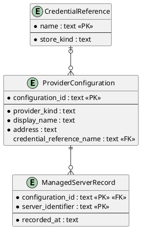

# Entity Relationship Diagram

## Metadata
| Key | Value |
| --- | --- |
| ID | ERD-001 |
| CrossReference | [DCD-001], [DICT-001], [ADR-0003] |

## Version History
| Date | Status | Author | Reviewer | Change | Commit |
| --- | --- | --- | --- | --- | --- |
| 2026-10-15 | Deprecated | Jens Tirsvad Nielsen | AI (named by S01) | Entities use the IT terms of the dictionary; 1:N notation; sources match the DCD (RC review) Accepted after RC-039 | [de601dd] |
| 2026-10-15 | Accepted | Jens Tirsvad Nielsen | AI as stand-in for S02 | recorded_at is an ISO 8601 text with offset, matching the DCD Timestamp Accepted after RC-042 | pending |

---

## Purpose and Scope

The persisted data of the command-line client in its JSON Lines (JSONL) configuration
file: provider configurations, credential references and managed servers. One line holds
one record, and a `record_type` field names the entity. There is no entity for a secret:
no record has a field that could hold one ([ADR-0003]).

## Diagram

## Entity Table

### ProviderConfiguration

| Attribute | Type | PK/FK | Nullable | Source (DCD class.attribute) |
| --- | --- | --- | --- | --- |
| configuration_id | text | PK | No | ProviderConfiguration.configurationId |
| provider_kind | text | | No | ProviderConfiguration.providerKind |
| display_name | text | | No | ProviderConfiguration.displayName |
| address | text | | No | ProviderConfiguration.address |
| credential_reference_name | text | FK | Yes | ProviderConfiguration.credentialReference |

### CredentialReference

| Attribute | Type | PK/FK | Nullable | Source (DCD class.attribute) |
| --- | --- | --- | --- | --- |
| name | text | PK | No | CredentialReference.name |
| store_kind | text | | No | CredentialReference.storeKind |

### ManagedServerRecord

| Attribute | Type | PK/FK | Nullable | Source (DCD class.attribute) |
| --- | --- | --- | --- | --- |
| configuration_id | text | PK, FK | No | ManagedServerRecord.configurationId |
| server_identifier | text | PK | No | ManagedServerRecord.serverIdentifier |
| recorded_at | text (ISO 8601 with offset) | | No | ManagedServerRecord.recordedAt (Timestamp) |

## Relationship Table

| Entity | Cardinality | Entity | FK | Rule |
| --- | --- | --- | --- | --- |
| CredentialReference | 1:N (0..many) | ProviderConfiguration | credential_reference_name | A reference may be unused; a configuration has at most one. |
| ProviderConfiguration | 1:N (0..many) | ManagedServerRecord | configuration_id | A managed server belongs to exactly one configuration; deleting a configuration removes its records. |

## Normalization Notes

Third normal form: each non-key attribute depends on the key, the whole key and nothing
but the key. No denormalization. The file is read whole at start-up; no index is needed
at the expected size (tens of records).

---

[DCD-001]: ./dcd.md
[DICT-001]: ./dictionary.md
[ADR-0003]: ./adr/adr-0003-credential-storage.md
[de601dd]: https://git.tirsystem.com/TirSystem/iac-node-forge/commit/de601dd67be72a7d032de2146b4ec9cc8a213aec
