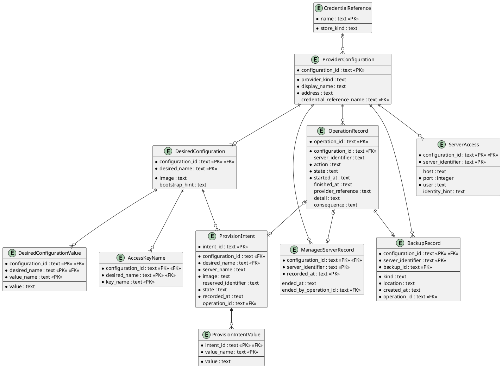

# Entity Relationship Diagram

## Metadata
| Key | Value |
| --- | --- |
| ID | ERD-001 |
| CrossReference | [DCD-001], [DICT-001], [ADR-0003], [ADR-0006], [ADR-0007], [ADR-0008], [ADR-0009], [ADR-0010] |

## Version History
| Date | Status | Author | Reviewer | Change | Commit |
| --- | --- | --- | --- | --- | --- |
| 2026-10-18 | Deprecated | Jens Tirsvad Nielsen | AI as stand-in for S02 | Revision 6: ServerAccess (`server_access`: host, port, user, identity_hint) (MIL-007) Accepted after RC-103 | [f05b1dd] |
| 2026-10-25 | Accepted | Jens Tirsvad Nielsen | AI as stand-in for S02 | Revision 7: BackupRecord (`backup`: backup_id, kind, location, created_at, operation_id); OperationRecord.action also backup and restore (MIL-008) Accepted after RC-119 | pending |

---

## Purpose and Scope

The persisted data of the command-line client in its JSON Lines (JSONL) configuration
file: provider configurations, credential references, operations, managed servers, desired
configurations with their access key names and values, provision intents with their values, and the
connection facts of servers, and the backups of whole servers that this client made. A removal adds no entity: its consequence is a field of the operation,
and the managed-server record is ended, not deleted. A transfer adds no entity either: its report is a
local file written by the command ([ADR-0009]), and the host key is kept in the user's own
`known_hosts`, not here. A restore adds no entity either: its consequence is a field of the operation and the
state of the server afterwards is in the operation's detail. A backup adds one: `BackupRecord` says where a backup
that this client made is kept ([ADR-0010]); the provider remains the authority for what exists, so the record is
never the only source of a list.
One client has one file. One line holds one record, and a `record_type` field names the entity;
a child entity is a line of its own. There is no entity for a secret:
no record has a field that could hold one ([ADR-0003]).

## Diagram

## Entity Table

### ProviderConfiguration

| Attribute | Type | PK/FK | Nullable | Source (DCD class.attribute) |
| --- | --- | --- | --- | --- |
| configuration_id | text | PK | No | ProviderConfiguration.configurationId |
| provider_kind | text | | No | ProviderConfiguration.providerKind |
| display_name | text | | No | ProviderConfiguration.displayName |
| address | text | | No | ProviderConfiguration.address |
| credential_reference_name | text | FK | Yes | ProviderConfiguration.credentialReference |

### CredentialReference

| Attribute | Type | PK/FK | Nullable | Source (DCD class.attribute) |
| --- | --- | --- | --- | --- |
| name | text | PK | No | CredentialReference.name |
| store_kind | text | | No | CredentialReference.storeKind |

### ManagedServerRecord

| Attribute | Type | PK/FK | Nullable | Source (DCD class.attribute) |
| --- | --- | --- | --- | --- |
| configuration_id | text | PK, FK | No | ManagedServerRecord.configurationId |
| server_identifier | text | PK | No | ManagedServerRecord.serverIdentifier |
| recorded_at | text (ISO 8601 with offset) | PK | No | ManagedServerRecord.recordedAt (Timestamp) |
| ended_at | text (ISO 8601 with offset) | | Yes | ManagedServerRecord.endedAt (empty while the server is managed; set when a removal succeeded) |
| ended_by_operation_id | text | FK | Yes | ManagedServerRecord.endedByOperationId (the removal operation that ended the record) |

### OperationRecord

| Attribute | Type | PK/FK | Nullable | Source (DCD class.attribute) |
| --- | --- | --- | --- | --- |
| operation_id | text | PK | No | Operation.operationId |
| configuration_id | text | FK | No | Operation.configurationId |
| server_identifier | text | | Yes | Operation.serverIdentifier (empty for a provision operation until the provider names the server) |
| action | text | | No | Operation.action (PowerAction: start, shutdown, stop, restart, provision, remove, backup or restore) |
| state | text | | No | Operation.state (OperationState) |
| started_at | text (ISO 8601 with offset) | | No | Operation.startedAt |
| finished_at | text (ISO 8601 with offset) | | Yes | Operation.finishedAt |
| provider_reference | text | | Yes | Operation.providerReference (a task identifier, not a secret) |
| detail | text | | Yes | Operation.detail (bounded, never a credential or header; for a cancellation also the effective date the provider reports, for a restore the state of the server read afterwards) |
| consequence | text (at most 500 characters) | | Yes | Operation.consequence (the text shown before a removal, a backup or a restore was confirmed; empty for every other action; never a credential) |

### BackupRecord

The `record_type` is `backup`. It is written when a backup operation has succeeded and the provider lists the
backup it made. There is no field for a credential, a token or a key; `location` is a place (a storage and its
node, or a provider), never an address with a credential.

| Attribute | Type | PK/FK | Nullable | Source (DCD class.attribute) |
| --- | --- | --- | --- | --- |
| configuration_id | text | PK, FK | No | BackupRecord.configurationId |
| server_identifier | text | PK | No | BackupRecord.serverIdentifier |
| backup_id | text (provider-specific: a Proxmox VE `volid`, a Contabo `snapshotId`) | PK | No | BackupRecord.backupId |
| kind | text (`archive` or `snapshot`) | | No | BackupRecord.kind (BackupKind) |
| location | text (at most 500 characters) | | No | BackupRecord.location |
| created_at | text (ISO 8601 with offset) | | No | BackupRecord.createdAt (Timestamp; the creation time the provider reports) |
| operation_id | text | FK | No | BackupRecord.operationId (the backup operation that made it) |

### ServerAccess

The `record_type` is `server_access`. There is no field for a password, a passphrase, a key or a token.

| Attribute | Type | PK/FK | Nullable | Source (DCD class.attribute) |
| --- | --- | --- | --- | --- |
| configuration_id | text | PK, FK | No | ServerAccess.configurationId |
| server_identifier | text | PK | No | ServerAccess.serverIdentifier |
| host | text (a name or an address) | | Yes | ServerAccess.host (empty: the first address the provider reports for the server is used at the time of a transfer) |
| port | integer (1 to 65535) | | No | ServerAccess.port (22 when not given) |
| user | text | | No | ServerAccess.user |
| identity_hint | text (at most 500 characters; a file path or a note, never a key) | | Yes | ServerAccess.identityHint |

### DesiredConfiguration

| Attribute | Type | PK/FK | Nullable | Source (DCD class.attribute) |
| --- | --- | --- | --- | --- |
| configuration_id | text | PK, FK | No | DesiredConfiguration.configurationId |
| desired_name | text | PK | No | DesiredConfiguration.desiredName |
| image | text | | No | DesiredConfiguration.image |
| bootstrap_hint | text (at most 500 characters) | | Yes | DesiredConfiguration.bootstrapHint |

### AccessKeyName

| Attribute | Type | PK/FK | Nullable | Source (DCD class.attribute) |
| --- | --- | --- | --- | --- |
| configuration_id | text | PK, FK | No | DesiredConfiguration.configurationId |
| desired_name | text | PK, FK | No | DesiredConfiguration.desiredName |
| key_name | text (a name, never a key value) | PK | No | DesiredConfiguration.accessKeyNames (one entry) |

### DesiredConfigurationValue

| Attribute | Type | PK/FK | Nullable | Source (DCD class.attribute) |
| --- | --- | --- | --- | --- |
| configuration_id | text | PK, FK | No | DesiredConfiguration.configurationId |
| desired_name | text | PK, FK | No | DesiredConfiguration.desiredName |
| value_name | text | PK | No | ProviderValue.name |
| value | text | | No | ProviderValue.value |

### ProvisionIntent

| Attribute | Type | PK/FK | Nullable | Source (DCD class.attribute) |
| --- | --- | --- | --- | --- |
| intent_id | text | PK | No | ProvisionIntent.intentId |
| configuration_id | text | FK | No | ProvisionIntent.configurationId |
| desired_name | text | FK | No | ProvisionIntent.desiredName |
| server_name | text | | No | ProvisionIntent.serverName |
| image | text | | No | ProvisionIntent.image (a copy at the time of the request) |
| reserved_identifier | text | | Yes | ProvisionIntent.reservedIdentifier (Proxmox VE identifier from `nextid`; empty for Contabo) |
| state | text (`pending` or `ended`) | | No | ProvisionIntent.state (IntentState) |
| recorded_at | text (ISO 8601 with offset) | | No | ProvisionIntent.recordedAt (Timestamp) |
| operation_id | text | FK | Yes | ProvisionIntent.operationId (empty until the request is made) |

### ProvisionIntentValue

| Attribute | Type | PK/FK | Nullable | Source (DCD class.attribute) |
| --- | --- | --- | --- | --- |
| intent_id | text | PK, FK | No | ProvisionIntent.intentId |
| value_name | text | PK | No | ProviderValue.name |
| value | text | | No | ProviderValue.value (a copy at the time of the request) |

## Relationship Table

| Entity | Cardinality | Entity | FK | Rule |
| --- | --- | --- | --- | --- |
| CredentialReference | 1:N (0..many) | ProviderConfiguration | credential_reference_name | A reference may be unused; a configuration has at most one. |
| ProviderConfiguration | 1:N (0..many) | OperationRecord | configuration_id | An operation belongs to the configuration it was requested through; deleting a configuration removes its records. |
| ProviderConfiguration | 1:N (0..many) | ManagedServerRecord | configuration_id | A managed server belongs to exactly one configuration; deleting a configuration removes its records. |
| ProviderConfiguration | 1:N (0..many) | DesiredConfiguration | configuration_id | A desired configuration belongs to exactly one configuration; its name is unique within it; deleting a configuration removes its records. |
| ProviderConfiguration | 1:N (0..many) | ServerAccess | configuration_id | The connection facts of a server belong to the configuration it is run through; there is at most one per (configuration, server); saving again replaces it; deleting a configuration removes its records. The server is not an entity of this file, as for ManagedServerRecord and OperationRecord. |
| ProviderConfiguration | 1:N (0..many) | BackupRecord | configuration_id | A backup record belongs to the configuration it was made through; there is at most one per (configuration, server, backup); deleting a configuration removes its records. The server is not an entity of this file. A record is never deleted by this client: a backup that the provider no longer lists is reported as gone and the record stays. |
| DesiredConfiguration | 1:N (0..many) | AccessKeyName | configuration_id, desired_name | The names of the access keys to install; removed with the desired configuration. |
| DesiredConfiguration | 1:N (0..many) | DesiredConfigurationValue | configuration_id, desired_name | The provider-specific values; replaced with the desired configuration. |
| DesiredConfiguration | 1:N (0..many) | ProvisionIntent | configuration_id, desired_name | An intent is made from one desired configuration; replacing the desired configuration keeps the key, so the intent stays valid. |
| ProvisionIntent | 1:N (0..many) | ProvisionIntentValue | intent_id | The values chosen at the time of the request; removed with the intent. |
| OperationRecord | 1:1 (optional on both sides) | ManagedServerRecord | ended_by_operation_id | A record is ended by at most one removal operation, and a removal operation ends at most one record (none for a server this client did not manage); the record is kept, never deleted, when it is ended. |
| OperationRecord | 1:1 (optional on the operation side) | BackupRecord | operation_id | A backup record is made by exactly one backup operation, and a backup operation makes at most one record (none when it failed, ended unknown or the backup could not be located). |
| OperationRecord | 1:1 (optional on both sides) | ProvisionIntent | operation_id | An intent has at most one operation, set when the request is made; a provision operation has exactly one intent, a power operation none. |

## Normalization Notes

Third normal form: each non-key attribute depends on the key, the whole key and nothing
but the key. The lists (access key names, values) are child entities, not repeated or
multi-valued attributes. The one denormalization is deliberate: a ProvisionIntent keeps a copy of
the image and the values, so that changing the desired configuration later does not change the
record of what was requested. A removal keeps the consequence on the operation and ends the
managed-server record (`ended_at` set) instead of deleting it, so the history of what this client
managed is kept; the key of the record includes `recorded_at`, because Proxmox VE reuses a freed
identifier and a server created later with the same identifier is a new record. A line written
before this revision has no `ended_at` and is read as not ended. A BackupRecord depends on its key alone; `kind` and `created_at` are copied from the provider's report when the backup is located, so that the list still shows them after the provider's listing has changed, and the provider's list stays the authority. A ServerAccess depends on its key alone; it holds the facts as given, and the address that the provider reports is not copied into it, so that a changed address is followed. The file is read whole at start-up; no index is needed
at the expected size (tens of records).

---

[DCD-001]: ./dcd.md
[DICT-001]: ./dictionary.md
[ADR-0003]: ./adr/adr-0003-credential-storage.md
[ADR-0006]: ./adr/adr-0006-power-actions-and-operation-tracking.md
[ADR-0007]: ./adr/adr-0007-desired-configuration-and-provisioning.md
[ADR-0008]: ./adr/adr-0008-removal-of-a-server.md
[ADR-0009]: ./adr/adr-0009-server-access-and-file-transfer.md
[ADR-0010]: ./adr/adr-0010-whole-server-backup-and-restore.md
[f05b1dd]: https://git.tirsystem.com/TirSystem/iac-node-forge/commit/f05b1dd98b3282a9b01ed2875fb706e6326af769
