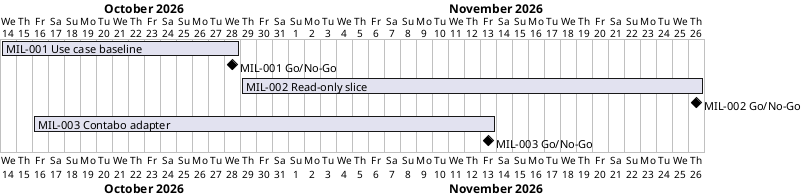

# Project Plan

## Metadata
| Key | Value |
| --- | --- |
| ID | PP-001 |
| CrossReference | [BC-001], [SA-001], [MIL-001], [MIL-002], [MIL-003] |
| Language | en |
| Domain | it |

## Version History
| Date | Status | Author | Reviewer | Change | Commit |
| --- | --- | --- | --- | --- | --- |
| 2026-10-15 | Deprecated | Jens Tirsvad Nielsen | S02 | Scheduled MIL-003, the Contabo read-only adapter | [d59571d] |
| 2026-10-15 | Accepted | Jens Tirsvad Nielsen | AI as stand-in for S02 | Accepted after RC-048 (autonomous mode, stand-in) | [c1c8c1c] |

---

## Purpose

Schedule the phases (gateways) of iac-node-forge from the agreed use cases to
working software. Only the first phase is planned in detail. The Business Case
states no duration or deadline yet, so the plan has no fixed end date.

## Planning Assumptions

- The plan starts on 2026-10-14, confirmed by S01 on 2026-10-15.
- Phase length for MIL-001 is two weeks, confirmed by S01 on 2026-10-15.
- Each phase ends with a Go/No-Go decision by S01, after a review by S02
  ([SA-001]).
- Later phases are planned only after the phase before them is accepted. MIL-002 is
  planned after MIL-001 was accepted on 2026-10-15.
- The MIL-002 window (2026-10-29 to 2026-11-26) was confirmed by S01 on 2026-10-15.
- MIL-002 was completed on 2026-10-15, earlier than its window. MIL-003 starts the next day.
- The second software milestone is the Contabo read-only adapter, chosen by S01 on 2026-10-15.
- The first software milestone is a read-only slice: Proxmox VE with the Python command-line
  interface (CLI), decided by S01 on 2026-10-15.

## Gateway Schedule

| Gateway | Document | Window | Decision date | Owner | Stories | Main deliverable | Milestone |
| --- | --- | --- | --- | --- | --- | --- | --- |
| Use case baseline | [MIL-001] | 2026-10-14 to 2026-10-28 | 2026-10-28 | S01 | UC-01 to UC-19 (candidates) | Use Case Diagram, brief use cases, verified provider facts, ADRs | |
| Read-only slice: Proxmox VE with the Python CLI | [MIL-002] | 2026-10-29 to 2026-11-26 | 2026-11-26 | S01 | US-001.01, US-001.02, US-001.06 | Python CLI for UC-01, UC-02 and UC-07 against Proxmox VE, design artifacts, mock application programming interface (API), continuous integration (CI) | |
| Contabo read-only adapter | [MIL-003] | 2026-10-16 to 2026-11-13 | 2026-11-13 | S01 | US-001.01, US-001.02, US-001.06 | Contabo adapter behind the same port, multi-value credentials, mock and provider-neutral contract suite, read-only live run | |



## Scope Coverage

| Business Case scope item | Gateway |
| --- | --- |
| Provider access and validation for Proxmox VE and Contabo | MIL-001 (use cases); MIL-002 (Proxmox VE with the CLI); MIL-003 (Contabo, read-only) |
| Server lifecycle use cases | MIL-001 (use cases); MIL-002 and MIL-003 (discover and list only); others not yet planned |
| Display of servers not managed by this client | MIL-001 (use case UC-07); MIL-002 and MIL-003 (read-only list) |
| Python command-line interface (CLI) and WinUI 3 application | MIL-002 and MIL-003 (CLI, three use cases); WinUI 3 not yet planned |
| JSON Lines (JSONL) configuration file per client | MIL-002 (CLI client) |

## Dependencies

```
MIL-001 Use case baseline -> MIL-002 Read-only slice (Proxmox VE, CLI) -> MIL-003 Contabo read-only adapter -> (later phases, not yet planned)
```

A No-Go on MIL-001 delays every later phase, because nothing under `src/` or
`tests/` may start before an accepted, reviewed milestone.

## Plan Risks

| Risk | Impact | Mitigation |
| --- | --- | --- |
| Provider API facts turn out different from the assumptions in the use case list | Use cases change after MIL-001 | MIL-001 includes a task that verifies provider behaviour against the documentation before acceptance |
| Only one reviewer (S02) is available | Review becomes a bottleneck | Keep MIL-001 small; review documents as they are produced |
| Gitea CI cannot run a Proxmox VE virtual machine (VM) | Integration tests on Proxmox cannot gate merges | Test strategy architecture decision record (ADR) in MIL-001 sets CI to mock-based contract tests; the VM runs outside CI |
| Contabo differs from Proxmox VE in credentials (four values and a short-lived token) and has no task model | The common interface needs a change that Proxmox VE did not require | MIL-003 starts with a decision record and a design revision before any code |
| The live Contabo run needs real API credentials | Go criterion 7 cannot be met without S01 | Read-only calls cost nothing; the run is the last task and S01 supplies the credentials in their own shell |
| No deadline or budget limit (confirmed by S01) | Plan cannot be checked against a constraint | Plan later phases by effort; revisit if a deadline appears |

## Open Issues

- The MIL-003 window (2026-10-16 to 2026-11-13) is an assumption to be confirmed by S01.
- Which milestone follows MIL-003 (power control, provisioning, WinUI 3, file backup) is decided when MIL-003 has a Go.
- Later phases (state-changing actions, second provider, second client) are
  candidates only and have no `MIL-*` document yet.
- The diagram, with MIL-002, was rendered on `plantuml.tirsystem.com` on 2026-10-15
  without error.

---

[BC-001]: ./business-case.md
[SA-001]: ./stakeholder-analysis.md
[MIL-001]: ./milestones/mil-001-use-case-baseline.md
[MIL-002]: ./milestones/mil-002-read-only-slice-proxmox-cli.md
[MIL-003]: ./milestones/mil-003-contabo-read-only-adapter.md
[d59571d]: https://git.tirsystem.com/TirSystem/iac-node-forge/commit/d59571d87e5e2c2d19aa490850422180c720a45e
[c1c8c1c]: https://git.tirsystem.com/TirSystem/iac-node-forge/commit/c1c8c1cede20ea80be9c04babfe83175b00328a9
