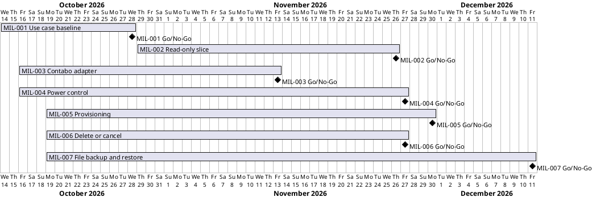

# Project Plan

## Metadata
| Key | Value |
| --- | --- |
| ID | PP-001 |
| CrossReference | [BC-001], [SA-001], [MIL-001], [MIL-002], [MIL-003], [MIL-004], [MIL-005], [MIL-006], [MIL-007] |
| Language | en |
| Domain | it |

## Version History
| Date | Status | Author | Reviewer | Change | Commit |
| --- | --- | --- | --- | --- | --- |
| 2026-10-18 | Deprecated | Jens Tirsvad Nielsen | AI as stand-in for S02 | Accepted after RC-082 (autonomous mode, stand-in) | [f4145ff] |
| 2026-10-18 | Accepted | Jens Tirsvad Nielsen | AI as stand-in for S02 | Accepted after RC-094 (autonomous mode, stand-in) | pending |

---

## Purpose

Schedule the phases (gateways) of iac-node-forge from the agreed use cases to
working software. Only the first phase is planned in detail. The Business Case
states no duration or deadline yet, so the plan has no fixed end date.

## Planning Assumptions

- The plan starts on 2026-10-14, confirmed by S01 on 2026-10-15.
- Phase length for MIL-001 is two weeks, confirmed by S01 on 2026-10-15.
- Each phase ends with a Go/No-Go decision by S01, after a review by S02
  ([SA-001]).
- Later phases are planned only after the phase before them is accepted. MIL-002 is
  planned after MIL-001 was accepted on 2026-10-15.
- The MIL-002 window (2026-10-29 to 2026-11-26) was confirmed by S01 on 2026-10-15.
- MIL-002 was completed on 2026-10-15, earlier than its window. MIL-003 starts the next day.
- The second software milestone is the Contabo read-only adapter, chosen by S01 on 2026-10-15.
- The third software milestone is power control (start, shutdown, stop, restart and operation
  tracking) for both providers, chosen by S01 on 2026-10-15; it is the first action that changes state.
- The fourth software milestone is provisioning (the desired configuration and the creation of a
  server), chosen by S01 on 2026-10-18; it is the first action that creates something and may cost money.
- The fifth software milestone is the removal of a server (delete or cancel), chosen by S01 on 2026-10-18;
  it is the first action that cannot be undone.
- The sixth software milestone is file backup and restore, chosen by S01 on 2026-10-18; it is the first slice
  that reaches the inside of a server over SSH and does not depend on the provider.
- The first software milestone is a read-only slice: Proxmox VE with the Python command-line
  interface (CLI), decided by S01 on 2026-10-15.

## Gateway Schedule

| Gateway | Document | Window | Decision date | Owner | Stories | Main deliverable | Milestone |
| --- | --- | --- | --- | --- | --- | --- | --- |
| Use case baseline | [MIL-001] | 2026-10-14 to 2026-10-28 | 2026-10-28 | S01 | UC-01 to UC-19 (candidates) | Use Case Diagram, brief use cases, verified provider facts, ADRs | |
| Read-only slice: Proxmox VE with the Python CLI | [MIL-002] | 2026-10-29 to 2026-11-26 | 2026-11-26 | S01 | US-001.01, US-001.02, US-001.06 | Python CLI for UC-01, UC-02 and UC-07 against Proxmox VE, design artifacts, mock application programming interface (API), continuous integration (CI) | |
| Contabo read-only adapter | [MIL-003] | 2026-10-16 to 2026-11-13 | 2026-11-13 | S01 | US-001.01, US-001.02, US-001.06 | Contabo adapter behind the same port, multi-value credentials, mock and provider-neutral contract suite, read-only live run | |
| Power control | [MIL-004] | 2026-10-16 to 2026-11-27 | 2026-11-27 | S01 | US-001.05, US-001.07 | Power actions and operation tracking for Proxmox VE and Contabo through the CLI, operation record, power contract suite, opt-in live run | |
| Provisioning | [MIL-005] | 2026-10-19 to 2026-11-30 | 2026-11-30 | S01 | US-001.03, US-001.04 | Desired configuration and server creation for Proxmox VE and Contabo through the CLI, cost confirmation, protection against duplicate creation, managed-server record, provisioning contract suite, opt-in live run in the Docker Proxmox VE | |
| Delete or cancel a server | [MIL-006] | 2026-10-19 to 2026-11-27 | 2026-11-27 | S01 | US-001.08 | Removal of a server at Proxmox VE (destroy) and Contabo (cancel with an effective date) through the CLI, protection against accidental removal, removal record, removal contract suite, opt-in live run in the Docker Proxmox VE | |
| File backup and restore | [MIL-007] | 2026-10-19 to 2026-12-11 | 2026-12-11 | S01 | US-001.09, US-001.10 | Backup of server files to the local PC and restore to a server over SSH through the CLI, verified copies, overwrite preview, host key rules, transfer contract suite, opt-in round trip against a throw-away SSH server | |



## Scope Coverage

| Business Case scope item | Gateway |
| --- | --- |
| Provider access and validation for Proxmox VE and Contabo | MIL-001 (use cases); MIL-002 (Proxmox VE with the CLI); MIL-003 (Contabo, read-only) |
| Server lifecycle use cases | MIL-001 (use cases); MIL-002 and MIL-003 (discover and list); MIL-004 (power control); MIL-005 (define and provision); MIL-006 (delete or cancel); MIL-007 (file backup and restore); others not yet planned |
| Display of servers not managed by this client | MIL-001 (use case UC-07); MIL-002 and MIL-003 (read-only list) |
| Python command-line interface (CLI) and WinUI 3 application | MIL-002 and MIL-003 (CLI, three use cases); WinUI 3 not yet planned |
| JSON Lines (JSONL) configuration file per client | MIL-002 (CLI client) |

## Dependencies

```
MIL-001 Use case baseline -> MIL-002 Read-only slice (Proxmox VE, CLI) -> MIL-003 Contabo read-only adapter -> MIL-004 Power control -> MIL-005 Provisioning -> MIL-006 Delete or cancel -> MIL-007 File backup and restore -> (later phases, not yet planned)
```

A No-Go on MIL-001 delays every later phase, because nothing under `src/` or
`tests/` may start before an accepted, reviewed milestone.

## Plan Risks

| Risk | Impact | Mitigation |
| --- | --- | --- |
| Provider API facts turn out different from the assumptions in the use case list | Use cases change after MIL-001 | MIL-001 includes a task that verifies provider behaviour against the documentation before acceptance |
| Only one reviewer (S02) is available | Review becomes a bottleneck | Keep MIL-001 small; review documents as they are produced |
| Gitea CI cannot run a Proxmox VE virtual machine (VM) | Integration tests on Proxmox cannot gate merges | Test strategy architecture decision record (ADR) in MIL-001 sets CI to mock-based contract tests; the VM runs outside CI |
| Contabo differs from Proxmox VE in credentials (four values and a short-lived token) and has no task model | The common interface needs a change that Proxmox VE did not require | MIL-003 starts with a decision record and a design revision before any code |
| The live Contabo run needs real API credentials | Go criterion 7 cannot be met without S01 | Read-only calls cost nothing; the run is the last task and S01 supplies the credentials in their own shell |
| The first state-changing action can turn a real server off | Unwanted downtime or data loss during tests | Tests run against mocks; the live run needs a disposable server named by S01 and an explicit opt-in; no delete, cancel or reinstall request exists in the code |
| No server is recorded as managed by this client yet | Every power action needs the extra confirmation | Accepted for this milestone; adoption of a server belongs to the provisioning milestone |
| Provisioning at Contabo commits the account to a contract period and costs money | An unwanted or duplicate order | The cost and period are shown and confirmed before any request; a retry looks for the name first and records its intent; no Contabo instance is created in tests |
| The product has no delete yet (UC-012 is a later milestone) | A server created in a test cannot be removed by the product | The live test runs only in the Docker Proxmox VE and removes what it created with a test-only helper; the container is deleted afterwards |
| Removal cannot be undone: Proxmox VE destroys the server and its disks at once | Lost data or a lost server | The consequence is stated first, the identifier is always typed, an unmanaged server needs one more confirmation, a running server is refused; tests run against mocks and a throw-away Docker Proxmox VE |
| Contabo only records a cancellation, and the rule for the cancel date is not stated | The contract runs on and is billed until the provider's date | The date the provider reports is shown and recorded; no Contabo instance is cancelled in tests |
| A restore overwrites data on a server | Lost data on the server | The files that would be overwritten are listed first, the identifier is confirmed, a server not managed by this client needs one more confirmation, and a copy is verified by a hash of every file |
| The product reaches the server with the user's own SSH identity | A wrong or spoofed server receives data | The host key is checked against the user's `known_hosts`; an unknown key needs explicit acceptance and a changed key stops the transfer; no key, password or passphrase is stored or put on a command line |
| No deadline or budget limit (confirmed by S01) | Plan cannot be checked against a constraint | Plan later phases by effort; revisit if a deadline appears |

## Open Issues

- The MIL-003 window (2026-10-16 to 2026-11-13) is an assumption to be confirmed by S01.
- The MIL-004 window (2026-10-16 to 2026-11-27) is an assumption to be confirmed by S01.
- The MIL-005 window (2026-10-19 to 2026-11-30) is an assumption to be confirmed by S01.
- The MIL-006 window (2026-10-19 to 2026-11-27) is an assumption to be confirmed by S01.
- The MIL-007 window (2026-10-19 to 2026-12-11) is an assumption to be confirmed by S01.
- Which milestone follows MIL-007 (whole-server backup, snapshots, WinUI 3) is decided when MIL-007 has a Go.
- Later phases (state-changing actions, second provider, second client) are
  candidates only and have no `MIL-*` document yet.
- The diagram, with MIL-002, was rendered on `plantuml.tirsystem.com` on 2026-10-15
  without error.

---

[BC-001]: ./business-case.md
[SA-001]: ./stakeholder-analysis.md
[MIL-001]: ./milestones/mil-001-use-case-baseline.md
[MIL-002]: ./milestones/mil-002-read-only-slice-proxmox-cli.md
[MIL-003]: ./milestones/mil-003-contabo-read-only-adapter.md
[MIL-004]: ./milestones/mil-004-power-control.md
[MIL-005]: ./milestones/mil-005-provisioning.md
[MIL-006]: ./milestones/mil-006-delete-or-cancel.md
[MIL-007]: ./milestones/mil-007-file-backup-and-restore.md
[f4145ff]: https://git.tirsystem.com/TirSystem/iac-node-forge/commit/f4145ff47c7aa423e4b15592810956412a9d640a
