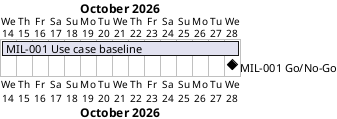

# Project Plan

## Metadata
| Key | Value |
| --- | --- |
| ID | PP-001 |
| CrossReference | [BC-001], [SA-001], [MIL-001] |
| Language | en |
| Domain | it |

## Version History
| Date | Status | Author | Reviewer | Change | Commit |
| --- | --- | --- | --- | --- | --- |
| 2026-10-15 | Deprecated | Jens Tirsvad Nielsen | S02 | Spelled out CLI and JSONL on first use (RC-003 criterion 10) | [dbd33d0] |
| 2026-10-15 | Accepted | Jens Tirsvad Nielsen | AI (named by S01) | Dates confirmed by S01; diagram rendered; accepted after RC-003 | [dbd33d0] |

---

## Purpose

Schedule the phases (gateways) of iac-node-forge from the agreed use cases to
working software. Only the first phase is planned in detail. The Business Case
states no duration or deadline yet, so the plan has no fixed end date.

## Planning Assumptions

- The plan starts on 2026-10-14, confirmed by S01 on 2026-10-15.
- Phase length for MIL-001 is two weeks, confirmed by S01 on 2026-10-15.
- Each phase ends with a Go/No-Go decision by S01, after a review by S02
  ([SA-001]).
- Later phases are planned only after MIL-001 is accepted.

## Gateway Schedule

| Gateway | Document | Window | Decision date | Owner | Stories | Main deliverable | Milestone |
| --- | --- | --- | --- | --- | --- | --- | --- |
| Use case baseline | [MIL-001] | 2026-10-14 to 2026-10-28 | 2026-10-28 | S01 | UC-01 to UC-19 (candidates) | Use Case Diagram, brief use cases, verified provider facts, ADRs | |



## Scope Coverage

| Business Case scope item | Gateway |
| --- | --- |
| Provider access and validation for Proxmox VE and Contabo | MIL-001 (use cases only); software not yet planned |
| Server lifecycle use cases | MIL-001 (use cases only); software not yet planned |
| Display of servers not managed by this client | MIL-001 (use case UC-07); software not yet planned |
| Python command-line interface (CLI) and WinUI 3 application | Not yet planned |
| JSON Lines (JSONL) configuration file per client | Not yet planned |

## Dependencies

```
MIL-001 Use case baseline -> (later phases, not yet planned)
```

A No-Go on MIL-001 delays every later phase, because nothing under `src/` or
`tests/` may start before an accepted, reviewed milestone.

## Plan Risks

| Risk | Impact | Mitigation |
| --- | --- | --- |
| Provider API facts turn out different from the assumptions in the use case list | Use cases change after MIL-001 | MIL-001 includes a task that verifies provider behaviour against the documentation before acceptance |
| Only one reviewer (S02) is available | Review becomes a bottleneck | Keep MIL-001 small; review documents as they are produced |
| Gitea CI cannot run a Proxmox VE VM | Integration tests on Proxmox cannot gate merges | Test strategy ADR in MIL-001 sets CI to mock-based contract tests; the VM runs outside CI |
| No deadline or budget limit (confirmed by S01) | Plan cannot be checked against a constraint | Plan later phases by effort; revisit if a deadline appears |

## Open Issues

- The diagram was rendered on `plantuml.tirsystem.com` on 2026-10-15 without error.
- Which provider comes first in the first working slice (Proxmox VE or
  Contabo) is not decided; it shapes the next phase.
- Which client comes first (CLI or WinUI 3) is not decided.
- Later phases (first slice on one provider, second provider, second client)
  are candidates only and have no `MIL-*` document yet.

---

[BC-001]: ./business-case.md
[SA-001]: ./stakeholder-analysis.md
[MIL-001]: ./milestones/mil-001-use-case-baseline.md
[dbd33d0]: https://git.tirsystem.com/TirSystem/iac-node-forge/commit/dbd33d0175390676b2d84637be50a8657360bf15
