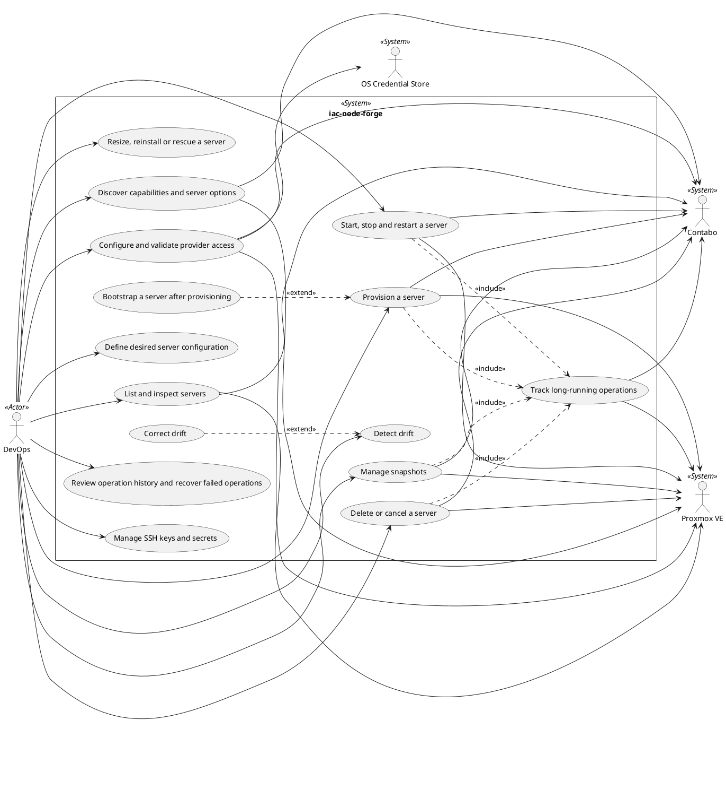

# Use Case Diagram

## Metadata
| Key | Value |
| --- | --- |
| ID | UCD-001 |
| CrossReference | [SA-001], [BC-001], [US-001], [UC-001], [UC-002], [UC-003], [UC-004], [UC-005], [UC-006], [UC-007], [UC-008], [UC-009], [UC-010], [UC-011], [UC-012], [UC-013], [UC-014], [UC-015] |
| Language | en |
| Domain | it |

## Version History
| Date | Status | Author | Reviewer | Change | Commit |
| --- | --- | --- | --- | --- | --- |
| 2026-10-14 | Proposed | Jens Tirsvad Nielsen | S02 | Initial version | [d6c95d9] |
| 2026-10-14 | Proposed | Jens Tirsvad Nielsen | S02 | Linked the use case documents UC-005, UC-009 to UC-011 and UC-013 to UC-015 | pending |

---

## Purpose and Scope

The diagram shows the goals DevOps pursues with iac-node-forge and the
external systems the product calls to reach them. The system boundary is the
product as a whole: the Python CLI and the WinUI 3 application are two
clients for the same use cases and are not drawn as separate systems.

In scope are the candidate use cases UC-001 to UC-015 agreed with the Product
Owner for [BC-001]. Tailscale or other VPN handling is out of scope for now.

All use cases UC-001 to UC-015 have Brief documents.

## Diagram

The diagram has not been rendered yet; check it with
`framework/scripts/render-diagrams.sh` before review.

## Actor Table

| Actor | Stereotype | Stakeholder ID (SA) | Goals (use cases) |
| --- | --- | --- | --- |
| DevOps | `<<Actor>>` (primary) | S02 | UC-001, UC-002, UC-003, UC-004, UC-007, UC-008, UC-009, UC-010, UC-012, UC-013, UC-014, UC-015 |
| Proxmox VE | `<<System>>` (secondary) | none, external system | UC-001, UC-002, UC-004, UC-006, UC-007, UC-008, UC-009, UC-012 |
| Contabo | `<<System>>` (secondary) | none, external system | UC-001, UC-002, UC-004, UC-006, UC-007, UC-008, UC-009, UC-012 |
| OS Credential Store | `<<System>>` (secondary) | none, external system | UC-001 |

The Product Owner (S01) has no use case of his own: he accepts artifacts and
does not operate the product, so he is not drawn as an actor.

## Use Case Table

| Use Case | Actor(s) | Goal | Document |
| --- | --- | --- | --- |
| UC-001 Configure and validate provider access | DevOps | Know that a provider can be used | [UC-001] |
| UC-002 Discover capabilities and server options | DevOps | See what a provider and target can do | [UC-002] |
| UC-003 Define desired server configuration | DevOps | Describe the server wanted | [UC-003] |
| UC-004 Provision a server | DevOps | Get a running server from a definition | [UC-004] |
| UC-005 Bootstrap a server after provisioning | DevOps | Make a new server usable | [UC-005] |
| UC-006 Track long-running operations | DevOps (via included use cases) | Know the outcome of an operation | [UC-006] |
| UC-007 List and inspect servers | DevOps | See what exists and what this client manages | [UC-007] |
| UC-008 Start, stop and restart a server | DevOps | Control power state | [UC-008] |
| UC-009 Manage snapshots | DevOps | Keep and restore point-in-time copies | [UC-009] |
| UC-010 Detect drift | DevOps | See where actual state differs from desired | [UC-010] |
| UC-011 Correct drift | DevOps (via detect drift) | Bring actual state back to desired | [UC-011] |
| UC-012 Delete or cancel a server | DevOps | Remove a server knowing the consequence | [UC-012] |
| UC-013 Review operation history and recover failed operations | DevOps | Understand and fix failures | [UC-013] |
| UC-014 Manage SSH keys and secrets | DevOps | Provide access keys to servers | [UC-014] |
| UC-015 Resize, reinstall or rescue a server | DevOps | Change an existing server | [UC-015] |

## Relationships

| Relationship | Justification |
| --- | --- |
| UC-004 `<<include>>` UC-006 | Provisioning always follows its operation to completion. |
| UC-008 `<<include>>` UC-006 | Power actions always follow their operation to completion. |
| UC-009 `<<include>>` UC-006 | Snapshot actions are long-running at the providers and are always followed. |
| UC-012 `<<include>>` UC-006 | Removal always follows its operation to completion. |
| UC-005 `<<extend>>` UC-004 | Bootstrap is optional and happens only after a server has been provisioned. |
| UC-011 `<<extend>>` UC-010 | Correction is offered only when drift has been detected. |

---

[SA-001]: ./stakeholder-analysis.md
[BC-001]: ./business-case.md
[US-001]: ./user-stories.md
[UC-001]: ./uc-001/uc.md
[UC-002]: ./uc-002/uc.md
[UC-003]: ./uc-003/uc.md
[UC-004]: ./uc-004/uc.md
[UC-005]: ./uc-005/uc.md
[UC-006]: ./uc-006/uc.md
[UC-007]: ./uc-007/uc.md
[UC-008]: ./uc-008/uc.md
[UC-009]: ./uc-009/uc.md
[UC-010]: ./uc-010/uc.md
[UC-011]: ./uc-011/uc.md
[UC-012]: ./uc-012/uc.md
[UC-013]: ./uc-013/uc.md
[UC-014]: ./uc-014/uc.md
[UC-015]: ./uc-015/uc.md
[d6c95d9]: https://git.tirsystem.com/TirSystem/iac-node-forge/commit/d6c95d9d3c454f4927e0639f96e0338880dca5fb
