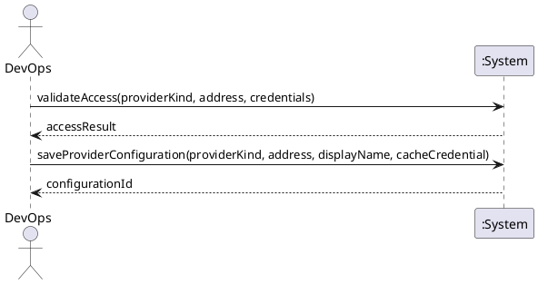

# System Sequence Diagram: Configure and validate provider access

## Metadata
| Key | Value |
| --- | --- |
| ID | SSD-001 |
| CrossReference | [UC-001], [DM-001] |
| Language | en |
| Domain | it |

## Version History
| Date | Status | Author | Reviewer | Change | Commit |
| --- | --- | --- | --- | --- | --- |
| 2026-10-15 | Proposed | Jens Tirsvad Nielsen | S02 | Initial version | pending |

---

## Source Use Case

Configure and validate provider access ([UC-001]) — scenario: main success scenario.
The alternate flow (credentials rejected) is out of scope of this diagram.

## Diagram

## System Operations

| Step | Message | Parameters | Return | Use case step |
| --- | --- | --- | --- | --- |
| 1 | validateAccess | provider kind, address, credentials (not stored) | access check: outcome and reason | "checks with the provider that authentication works ... and reports the result" |
| 2 | saveProviderConfiguration | provider kind, address, display name, whether to cache the credentials | configuration identifier | "the configuration is saved without any secret, and the credentials may be cached" |

## Lifecycle Notes

The credentials exist only for the duration of the `validateAccess` call and, when
caching is chosen, in the platform credential store. Nothing about them is kept in the
system instance after the call returns.

---

[UC-001]: ./uc.md
[DM-001]: ../../domain-model.md
