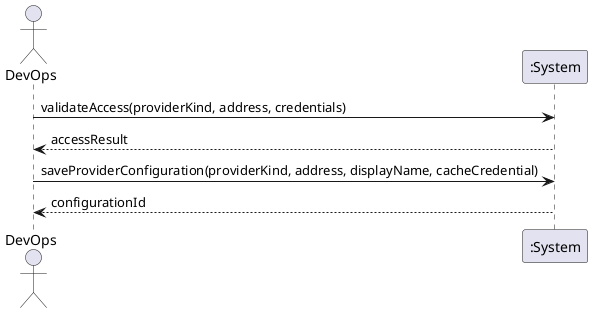

# System Sequence Diagram: Configure and validate provider access

## Metadata
| Key | Value |
| --- | --- |
| ID | SSD-001 |
| CrossReference | [UC-001], [DM-001] |
| Language | en |
| Domain | it |

## Version History
| Date | Status | Author | Reviewer | Change | Commit |
| --- | --- | --- | --- | --- | --- |
| 2026-10-15 | Deprecated | Jens Tirsvad Nielsen | AI (named by S01) | Accepted after RC-034 | [de601dd] |
| 2026-10-15 | Accepted | Jens Tirsvad Nielsen | AI as stand-in for S02 | Lifecycle note reconciled with the implementation Accepted after RC-041 | [6e1fc9a] |

---

## Source Use Case

Configure and validate provider access ([UC-001]) — scenario: main success scenario.
The alternate flow (credentials rejected) is out of scope of this diagram.

## Diagram

## System Operations

| Step | Message | Parameters | Return | Use case step |
| --- | --- | --- | --- | --- |
| 1 | validateAccess | provider kind, address, credentials (not stored) | access check: outcome and reason | "checks with the provider that authentication works ... and reports the result" |
| 2 | saveProviderConfiguration | provider kind, address, display name, whether to cache the credentials | configuration identifier | "the configuration is saved without any secret, and the credentials may be cached" |

## Lifecycle Notes

The credentials are held in memory by the system instance from `validateAccess` until
`saveProviderConfiguration` completes or the next `validateAccess` replaces them, because
the save may need them for the optional cache. They are never written to the configuration;
when caching is chosen they go to the platform credential store only.

---

[UC-001]: ./uc.md
[DM-001]: ../../domain-model.md
[de601dd]: https://git.tirsystem.com/TirSystem/iac-node-forge/commit/de601dd67be72a7d032de2146b4ec9cc8a213aec
[6e1fc9a]: https://git.tirsystem.com/TirSystem/iac-node-forge/commit/6e1fc9ab03ee8c75ad535849fee00964be1a3da4
