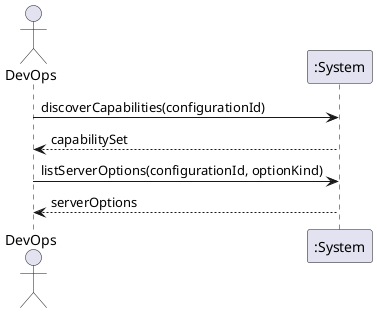

# System Sequence Diagram: Discover capabilities and server options

## Metadata
| Key | Value |
| --- | --- |
| ID | SSD-002 |
| CrossReference | [UC-002], [DM-001] |
| Language | en |
| Domain | it |

## Version History
| Date | Status | Author | Reviewer | Change | Commit |
| --- | --- | --- | --- | --- | --- |
| 2026-10-15 | Proposed | Jens Tirsvad Nielsen | S02 | Initial version | pending |

---

## Source Use Case

Discover capabilities and server options ([UC-002]) — scenario: main success scenario.

## Diagram

## System Operations

| Step | Message | Parameters | Return | Use case step |
| --- | --- | --- | --- | --- |
| 1 | discoverCapabilities | configuration identifier | set of capabilities of the provider and target | "the set of actions the provider and target support" |
| 2 | listServerOptions | configuration identifier, option kind | list of server options | "regions or nodes, images or templates, sizes or products, storage and network options" |

## Lifecycle Notes

Both messages are read-only. The credentials are obtained from the credential store or
asked for by the system; they are not a parameter of the operations here.

---

[UC-002]: ./uc.md
[DM-001]: ../../domain-model.md
