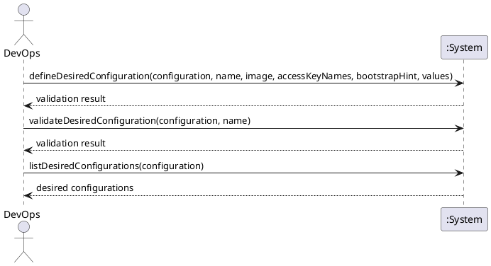

# System Sequence Diagram: Define desired server configuration

## Metadata
| Key | Value |
| --- | --- |
| ID | SSD-006 |
| CrossReference | [UC-003], [DM-001] |
| Language | en |
| Domain | it |

## Version History
| Date | Status | Author | Reviewer | Change | Commit |
| --- | --- | --- | --- | --- | --- |
| 2026-10-18 | Accepted | Jens Tirsvad Nielsen | AI as stand-in for S02 | Initial version Accepted after RC-072 | pending |

---

## Source Use Case

Define desired server configuration ([UC-003]) — scenario: main success scenario. The alternate
flow (a choice the provider does not offer) is stated in the return value: the description is
reported and not saved as valid, and the diagram does not repeat it.

## Diagram

## System Operations

| Step | Message | Parameters | Return | Use case step |
| --- | --- | --- | --- | --- |
| 1 | defineDesiredConfiguration | configuration (identifier or display name), name, image, access key names, bootstrap hint (optional), values (the provider-specific named values) | the validation result: the desired configuration as saved, or each unsupported or missing choice and that nothing was saved as valid | "describes the server wanted ... checks the description against the discovered capabilities and options, reports anything unsupported, and stores the validated description as a named desired configuration" |
| 2 | validateDesiredConfiguration | configuration, name | the validation result of a saved desired configuration checked again against what the provider offers now | "checks the description against the discovered capabilities and options" (a saved description is checked again before it is used, [UC-004]) |
| 3 | listDesiredConfigurations | configuration | the saved desired configurations of that provider configuration, each with its name, image, access key names, bootstrap hint and values | "stores the validated description as a named desired configuration" (a named description is found again by its name) |

Step 3 is a query and changes no state; it has no contract in [OC-004].

## Lifecycle Notes

The credentials are obtained from the credential store or asked for, as for every use case
([SSD-001]); the options are read through the same provider access as [SSD-002]. Nothing
about the description is kept in the system instance after it is saved. Only the names of
access keys are given; a key value is never part of a description.

---

[UC-003]: ./uc.md
[DM-001]: ../../domain-model.md
[SSD-001]: ../uc-001/ssd.md
[SSD-002]: ../uc-002/ssd.md
[UC-004]: ../uc-004/uc.md
[OC-004]: ./oc.md
