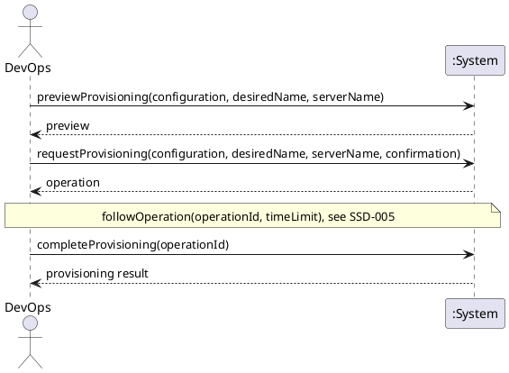

# System Sequence Diagram: Provision a server

## Metadata
| Key | Value |
| --- | --- |
| ID | SSD-007 |
| CrossReference | [UC-004], [DM-001] |
| Language | en |
| Domain | it |

## Version History
| Date | Status | Author | Reviewer | Change | Commit |
| --- | --- | --- | --- | --- | --- |
| 2026-10-18 | Accepted | Jens Tirsvad Nielsen | AI as stand-in for S02 | Initial version Accepted after RC-073 | [aa570c0] |

---

## Source Use Case

Provision a server ([UC-004]) — scenario: main success scenario. The alternate flows (the
desired configuration is missing or no longer valid, the provider does not support creation,
the name or an unfinished intent already exists, the confirmation is refused, the provider
rejects the request) end before any provider request or are reported by the same return
value; they are not drawn separately.

## Diagram

## System Operations

| Step | Message | Parameters | Return | Use case step |
| --- | --- | --- | --- | --- |
| 1 | previewProvisioning | configuration (identifier or display name), desired name, server name (optional; the desired name when absent) | the preview: provider, target, image, size, the values, the cost consequence (for a contract, its period and that the account is committed to it); or the reason it cannot be provisioned | "shows what will be created, including any cost or billing consequence the provider imposes" |
| 2 | requestProvisioning | configuration, desired name, server name, confirmation (given for this server) | the operation: identifier, action, state and detail; or the reason no request was sent | "asks for confirmation. After confirmation it submits the request to the provider" |
| 3 | completeProvisioning | operation identifier | the provisioning result: the server recorded as managed, or the state left at the provider | "records the new server as managed by this client"; on failure "the state left at the provider is reported" |

The following of the operation to its end between steps 2 and 3 is the use case [UC-006],
shown in [SSD-005].

## Lifecycle Notes

The credentials are obtained from the credential store or asked for, as for every use case
([SSD-001]). The intent to provision is kept from before the request until the operation ends
([OC-005]); nothing else about the request is kept in the system instance. Step 3 may be
called later for an operation that was not followed to its end.

---

[UC-004]: ./uc.md
[DM-001]: ../../domain-model.md
[SSD-001]: ../uc-001/ssd.md
[SSD-005]: ../uc-006/ssd.md
[UC-006]: ../uc-006/uc.md
[OC-005]: ./oc.md
[aa570c0]: https://git.tirsystem.com/TirSystem/iac-node-forge/commit/aa570c0d24a2840723ff9a2db0e146999ae69381
