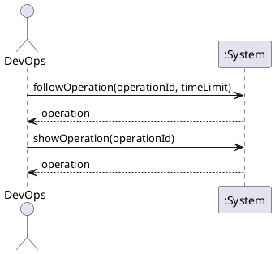

# System Sequence Diagram: Track long-running operations

## Metadata
| Key | Value |
| --- | --- |
| ID | SSD-005 |
| CrossReference | [UC-006], [DM-001] |
| Language | en |
| Domain | it |

## Version History
| Date | Status | Author | Reviewer | Change | Commit |
| --- | --- | --- | --- | --- | --- |
| 2026-10-15 | Accepted | Jens Tirsvad Nielsen | AI as stand-in for S02 | Initial version Accepted after RC-059 | [f91e283] |

---

## Source Use Case

Track long-running operations ([UC-006]) — scenario: main success scenario. The alternate
flow (the time limit passes) is stated in the return value and not drawn separately.

## Diagram

## System Operations

| Step | Message | Parameters | Return | Use case step |
| --- | --- | --- | --- | --- |
| 1 | followOperation | operation identifier, time limit | the operation in its final state: succeeded, failed or unknown, with its cause | "follows it to completion and keeps DevOps informed of its status, progress and outcome" |
| 2 | showOperation | operation identifier | the recorded operation | "recording the result so it can be reviewed later" |

## Lifecycle Notes

`followOperation` is called by the system itself after `requestPowerAction`; it is shown here
as a message because DevOps may also resume following an operation. The record is updated
once, when the operation ends.

---

[UC-006]: ./uc.md
[DM-001]: ../../domain-model.md
[f91e283]: https://git.tirsystem.com/TirSystem/iac-node-forge/commit/f91e283c8b54844b30c133036cb74d0cf4de80e0
