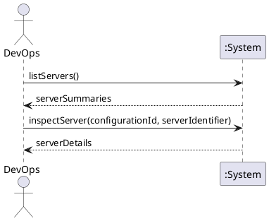

# System Sequence Diagram: List and inspect servers

## Metadata
| Key | Value |
| --- | --- |
| ID | SSD-003 |
| CrossReference | [UC-007], [DM-001] |
| Language | en |
| Domain | it |

## Version History
| Date | Status | Author | Reviewer | Change | Commit |
| --- | --- | --- | --- | --- | --- |
| 2026-10-15 | Proposed | Jens Tirsvad Nielsen | S02 | Initial version | pending |

---

## Source Use Case

List and inspect servers ([UC-007]) — scenario: main success scenario.

## Diagram

## System Operations

| Step | Message | Parameters | Return | Use case step |
| --- | --- | --- | --- | --- |
| 1 | listServers | none (all configured providers) | list of server summaries: provider, state, size, addresses, managed or not | "shows each server with its provider, state, size and addresses, marking those not managed by this client" |
| 2 | inspectServer | configuration identifier, server identifier | server details | "lets DevOps open one server to see its provider details" |

## Lifecycle Notes

Both messages are read-only. A provider that cannot be reached is reported in the
result without hiding the servers of the other providers.

---

[UC-007]: ./uc.md
[DM-001]: ../../domain-model.md
