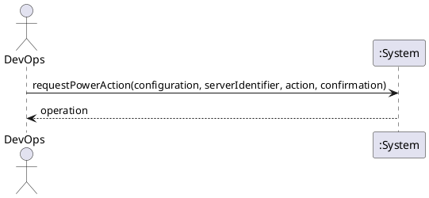

# System Sequence Diagram: Start, stop and restart a server

## Metadata
| Key | Value |
| --- | --- |
| ID | SSD-004 |
| CrossReference | [UC-008], [DM-001] |
| Language | en |
| Domain | it |

## Version History
| Date | Status | Author | Reviewer | Change | Commit |
| --- | --- | --- | --- | --- | --- |
| 2026-10-15 | Accepted | Jens Tirsvad Nielsen | AI as stand-in for S02 | Initial version Accepted after RC-058 | pending |

---

## Source Use Case

Start, stop and restart a server ([UC-008]) — scenario: main success scenario for one action.
The alternate flows (the action is unsupported, the confirmation is refused, the server is
already in the requested state, the provider rejects the request) are out of scope of this
diagram; each ends before any provider request or is reported by the same return value.

## Diagram

## System Operations

| Step | Message | Parameters | Return | Use case step |
| --- | --- | --- | --- | --- |
| 1 | requestPowerAction | configuration (identifier or display name), server identifier, action (start, shutdown, stop or restart), confirmation (given, and for an unmanaged server the retyped identifier) | the operation: identifier, action, state and detail; or the reason no request was sent | "checks that the provider supports the action, asks for confirmation ..., performs it" |

The following of the operation to its end is the use case [UC-006], shown in [SSD-005].

## Lifecycle Notes

The credentials are obtained from the credential store or asked for, as for every use case
([SSD-001]). Nothing about the request is kept in the system instance after the operation is
recorded.

---

[UC-008]: ./uc.md
[DM-001]: ../../domain-model.md
[SSD-001]: ../uc-001/ssd.md
[SSD-005]: ../uc-006/ssd.md
