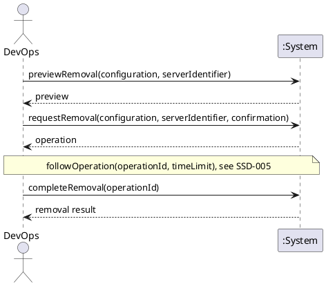

# System Sequence Diagram: Delete or cancel a server

## Metadata
| Key | Value |
| --- | --- |
| ID | SSD-008 |
| CrossReference | [UC-012], [DM-001] |
| Language | en |
| Domain | it |

## Version History
| Date | Status | Author | Reviewer | Change | Commit |
| --- | --- | --- | --- | --- | --- |
| 2026-10-18 | Accepted | Jens Tirsvad Nielsen | AI as stand-in for S02 | Initial version Accepted after RC-086 | pending |

---

## Source Use Case

Delete or cancel a server ([UC-012]) — scenario: main success scenario. The alternate flows
(the provider does not support removal, the server does not exist, it is running where the provider
requires it stopped, it is already removed or cancelled, the identifier typed does not match, the
confirmation is refused or the extra confirmation of an unmanaged server is missing, the provider
rejects the request) end before any provider request or are reported by the same return value;
they are not drawn separately.

## Diagram

## System Operations

| Step | Message | Parameters | Return | Use case step |
| --- | --- | --- | --- | --- |
| 1 | previewRemoval | configuration (identifier or display name), server identifier | the preview: provider, server, whether this client manages it, the removal kind (destroyed now, or cancelled with an effective date) and the consequence text; what confirmation is required (the identifier typed, and one more confirmation for a server not managed by this client); or the reason it cannot be removed (unsupported, not found, running, already removed) | "states what removal means at that provider, for example destroyed now or cancelled with an effective date, and asks for explicit confirmation, with an extra confirmation if the server is not managed by this client" |
| 2 | requestRemoval | configuration, server identifier, confirmation (the identifier typed, and for an unmanaged server the identifier typed again) | the operation: identifier, action, state, the consequence recorded and detail; or the reason no request was sent | "It then performs the removal" |
| 3 | completeRemoval | operation identifier | the removal result: the consequence, the state left at the provider (for a cancellation the effective date the provider reports) and whether the managed-server record was ended | "records the consequence"; on failure the state left at the provider is reported |

The following of the operation to its end between steps 2 and 3 is the use case [UC-006], shown
in [SSD-005].

## Lifecycle Notes

The credentials are obtained from the credential store or asked for, as for every use case
([SSD-001]). Nothing is kept in the system instance between the steps: the consequence is kept
with the operation ([OC-006]), and step 3 may be called later for an operation that was not
followed to its end. Nothing is sent to the provider before step 2, and then only the one removal
request.

---

[UC-012]: ./uc.md
[DM-001]: ../../domain-model.md
[SSD-001]: ../uc-001/ssd.md
[SSD-005]: ../uc-006/ssd.md
[UC-006]: ../uc-006/uc.md
[OC-006]: ./oc.md
