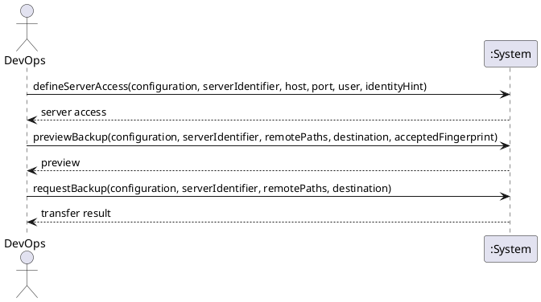

# System Sequence Diagram: Back up server files to the local PC

## Metadata
| Key | Value |
| --- | --- |
| ID | SSD-009 |
| CrossReference | [UC-016], [DM-001] |
| Language | en |
| Domain | it |

## Version History
| Date | Status | Author | Reviewer | Change | Commit |
| --- | --- | --- | --- | --- | --- |
| 2026-10-18 | Accepted | Jens Tirsvad Nielsen | AI as stand-in for S02 | Initial version Accepted after RC-098 | [f05b1dd] |

---

## Source Use Case

Back up server files to the local PC ([UC-016]) — scenario: main success scenario. The alternate
flows (the server does not exist or is not running, no access is recorded for it, a path does not exist,
the destination is not empty or has no room, the host key is unknown or changed, the connection fails,
the copy differs from its source) end before anything is copied or are reported by the same return
value; they are not drawn separately.

## Diagram

## System Operations

| Step | Message | Parameters | Return | Use case step |
| --- | --- | --- | --- | --- |
| 0 | defineServerAccess | configuration (identifier or display name), server identifier, host (optional; the address the provider reports is used when it is empty), port (optional; 22), user name, identity hint (optional) | the server access as kept: server, host (or that the provider's address is used), port, user name, identity hint; or the reason it was not kept (no such server, a user name is missing, a port outside the range) | Precondition "DevOps can authenticate to it": the facts needed to connect. Done once per server, before its first transfer; also used by [SSD-010] |
| 1 | previewBackup | configuration, server identifier, remote paths, destination on the local PC, accepted fingerprint (optional) | the preview: provider, server, host, port, user name, the host key and its fingerprint, the paths, the size to copy, the room at the destination and the margin required, and that nothing on the server is changed; or the reason nothing can be copied (see the alternate flows above); for an unknown host key the fingerprint and that it must be accepted | "The system connects to the server"; precondition "The destination on the local PC has room for the data" |
| 2 | requestBackup | configuration, server identifier, remote paths, destination | the transfer result: the outcome, and the transfer report (files, links and bytes copied, anything skipped, the differences found by the verification, the verification result and the report file); or the reason nothing was copied | "copies the chosen data to the destination, verifies that the copy is complete, and reports what was copied" |

A backup needs no confirmation: it changes nothing on the server and writes only to a destination that
is new or empty.

## Lifecycle Notes

The credentials of the provider are obtained from the credential store or asked for, as for every use
case ([SSD-001]); the server itself is reached with the user's own SSH identity and `known_hosts`, and no
secret of the server is asked for, stored or passed by the system ([ADR-0009]). Nothing is kept in the
system instance between the steps: the access facts are kept per server (step 0), the report is kept as
a file, and step 2 repeats every check of step 1. A host key that is unknown is accepted by giving its
fingerprint in step 1 (`acceptedFingerprint`); it must equal the one the system read from the server, and
it is then added to the user's `known_hosts`. Nothing else is written before step 2, and step 2 writes
only inside the destination. A changed host key is never accepted.

---

[UC-016]: ./uc.md
[DM-001]: ../../domain-model.md
[SSD-001]: ../uc-001/ssd.md
[SSD-010]: ../uc-017/ssd.md
[ADR-0009]: ../../adr/adr-0009-server-access-and-file-transfer.md
[f05b1dd]: https://git.tirsystem.com/TirSystem/iac-node-forge/commit/f05b1dd98b3282a9b01ed2875fb706e6326af769
