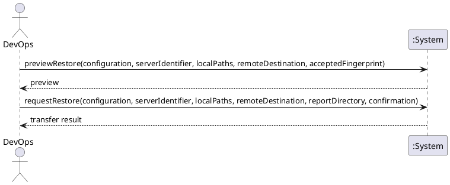

# System Sequence Diagram: Restore files from the local PC to the server

## Metadata
| Key | Value |
| --- | --- |
| ID | SSD-010 |
| CrossReference | [UC-017], [DM-001] |
| Language | en |
| Domain | it |

## Version History
| Date | Status | Author | Reviewer | Change | Commit |
| --- | --- | --- | --- | --- | --- |
| 2026-10-18 | Accepted | Jens Tirsvad Nielsen | AI as stand-in for S02 | Initial version Accepted after RC-100 | pending |

---

## Source Use Case

Restore files from the local PC to the server ([UC-017]) — scenario: main success scenario. The
alternate flows (the server does not exist or is not running, no access is recorded for it, a local
path does not exist, the host key is unknown or changed, the connection fails, the identifier typed does
not match, the confirmation is refused or the extra confirmation of an unmanaged server is missing, the
copy differs from its source) end before anything is written or are reported by the same return value;
they are not drawn separately. The recording of the server's access facts is `defineServerAccess`,
shown in [SSD-009].

## Diagram

## System Operations

| Step | Message | Parameters | Return | Use case step |
| --- | --- | --- | --- | --- |
| 1 | previewRestore | configuration (identifier or display name), server identifier, local paths, destination directory on the server, accepted fingerprint (optional) | the preview: provider, server, whether this client manages it, host, port, user name, the host key and its fingerprint, the paths and their size, the existing data on the server that would be overwritten (path, size, last changed) with the warning that it is not kept, and what confirmation is required (the identifier typed, and once more for a server not managed by this client); or the reason nothing can be restored; for an unknown host key the fingerprint and that it must be accepted | "The system states which existing data would be overwritten and asks for confirmation" |
| 2 | requestRestore | configuration, server identifier, local paths, destination directory on the server, directory for the report on the local PC, confirmation (the identifier typed, and for an unmanaged server the identifier typed again) | the transfer result: the outcome, and the transfer report (files, links and bytes copied, anything skipped, the data overwritten, the differences found by the verification, the verification result and the report file); or the reason nothing was written | "copies the data to the server, verifies that the copy is complete, and reports the result"; "Overwritten data is reported to DevOps before and after" |

The access facts of the server are those recorded with `defineServerAccess` ([SSD-009]).

## Lifecycle Notes

The credentials of the provider are obtained from the credential store or asked for, as for every use
case ([SSD-001]); the server itself is reached with the user's own SSH identity and `known_hosts`, and no
secret of the server is asked for, stored or passed by the system ([ADR-0009]). Nothing is kept in the
system instance between the steps, and step 2 repeats every check of step 1. The list of overwritten data
is shown in step 1 and reported again, with what was actually replaced, in step 2. Nothing is written on
the server, and nothing at the destination, before step 2 and a valid confirmation; the one exception is
the line added to the user's `known_hosts` when DevOps gives the fingerprint of an unknown host key in
step 1, which must equal the one the system read from the server. A changed host key is never accepted.

---

[UC-017]: ./uc.md
[DM-001]: ../../domain-model.md
[SSD-001]: ../uc-001/ssd.md
[SSD-009]: ../uc-016/ssd.md
[ADR-0009]: ../../adr/adr-0009-server-access-and-file-transfer.md
