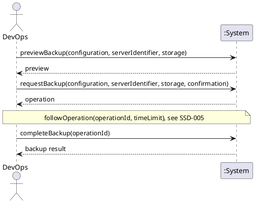

# System Sequence Diagram: Back up a whole server

## Metadata
| Key | Value |
| --- | --- |
| ID | SSD-011 |
| CrossReference | [UC-018], [DM-001] |
| Language | en |
| Domain | it |

## Version History
| Date | Status | Author | Reviewer | Change | Commit |
| --- | --- | --- | --- | --- | --- |
| 2026-10-25 | Accepted | Jens Tirsvad Nielsen | AI as stand-in for S02 | Initial version Accepted after RC-114 | [9fd15f2] |

---

## Source Use Case

Back up a whole server ([UC-018]) — scenario: main success scenario. The alternate flows (the provider
does not support backup, the server does not exist, the provider has no storage that accepts backups or the
storage named is not one, the server cannot be backed up now, the confirmation is refused, the provider rejects
the request, the operation ends unknown, the backup cannot be located afterwards) end before any provider request
or are reported by the same return value; they are not drawn separately. The step of the use case that copies the
backup to the local PC "where the provider allows" has no message: neither provider documents a way to do it
([ADR-0010], verification note B15, B22, B24), so the system never copies a backup.

## Diagram

## System Operations

| Step | Message | Parameters | Return | Use case step |
| --- | --- | --- | --- | --- |
| 1 | previewBackup | configuration (identifier or display name), server identifier, storage (optional; Proxmox VE only) | the preview: provider, server, the backup kind (an archive on a storage, or a snapshot held by the provider), where the backup will be kept, the consequence text (space and time; for a snapshot, that it is not an independent backup and that its cost is not stated) and that a plain confirmation is required; or the reason it cannot be made (unsupported, not found, no storage that accepts backups, several storages and none chosen, the storage is not for backups, not available) | "The system checks that the provider supports it" |
| 2 | requestBackup | configuration, server identifier, storage, confirmation | the operation: identifier, action, state, the consequence recorded and detail; or the reason no request was sent | "starts the backup" |
| 3 | completeBackup | operation identifier | the backup result: the backup (identifier, short alias, kind, where it is kept, when it was made, and the auto-delete date where the provider reports one) and that it was recorded; or that the backup could not be located, or the state left at the provider on a failure | "follows it to completion (UC-006), and reports where the backup is kept"; "The operation and its outcome are recorded" |

The following of the operation to its end between steps 2 and 3 is the use case [UC-006], shown in
[SSD-005].

## Lifecycle Notes

The credentials are obtained from the credential store or asked for, as for every use case ([SSD-001]).
Nothing is kept in the system instance between the steps: the consequence is kept with the operation
([OC-009]), and step 3 may be called later for an operation that was not followed to its end. Nothing
is sent to the provider that changes anything before step 2, and then only the one backup request; reading the
storages and the existing backups in step 1 changes nothing.

---

[UC-018]: ./uc.md
[DM-001]: ../../domain-model.md
[ADR-0010]: ../../adr/adr-0010-whole-server-backup-and-restore.md
[SSD-001]: ../uc-001/ssd.md
[SSD-005]: ../uc-006/ssd.md
[UC-006]: ../uc-006/uc.md
[OC-009]: ./oc.md
[9fd15f2]: https://git.tirsystem.com/TirSystem/iac-node-forge/commit/9fd15f248c031b5899ed480055d33b09a2ea62fa
