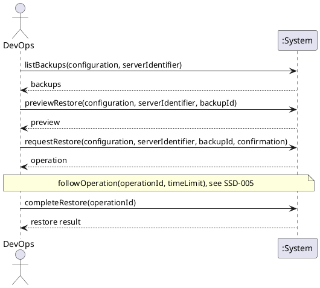

# System Sequence Diagram: Restore a whole server from a backup

## Metadata
| Key | Value |
| --- | --- |
| ID | SSD-012 |
| CrossReference | [UC-019], [DM-001] |
| Language | en |
| Domain | it |

## Version History
| Date | Status | Author | Reviewer | Change | Commit |
| --- | --- | --- | --- | --- | --- |
| 2026-10-25 | Accepted | Jens Tirsvad Nielsen | AI as stand-in for S02 | Initial version Accepted after RC-115 | pending |

---

## Source Use Case

Restore a whole server from a backup ([UC-019]) — scenario: main success scenario. The alternate flows (the
provider does not support restore, the server does not exist, the backup is not listed for the server or is of
another kind of guest, the server is running where the provider requires it stopped, the server is cancelled,
the identifier typed does not match, the confirmation is refused or the extra confirmation of an unmanaged
server is missing, the provider rejects the request, the operation ends unknown) end before any provider
request or are reported by the same return value; they are not drawn separately. The use case says "chooses a
backup and a target": the target is always the server the backup was made from (the same identifier), and the
backup is chosen from the list in step 1; a backup on the local PC is not offered ([ADR-0010]).

## Diagram

## System Operations

| Step | Message | Parameters | Return | Use case step |
| --- | --- | --- | --- | --- |
| 1 | listBackups | configuration (identifier or display name), server identifier | the backups the provider reports for the server, each with its identifier, short alias, kind, when it was made, where it is kept, its size where known, whether this client made it and the operation that made it; the backups recorded here that the provider no longer lists; or the reason it cannot be listed (unsupported, not found) | "DevOps chooses a backup" |
| 2 | previewRestore | configuration, server identifier, backup identifier (or its alias) | the preview: provider, server and its state, whether this client manages it, the backup, the restore effect (what is replaced, the backups the restore deletes by name and date, the cost where the provider states one, that it cannot be undone), and what confirmation is required (the identifier typed, and one more confirmation for a server not managed by this client); or the reason it cannot be restored (unsupported, not found, backup not found, wrong kind of guest, running, not available) | "The system states what the restore will replace and what it costs, asks for explicit confirmation" |
| 3 | requestRestore | configuration, server identifier, backup identifier, confirmation (the identifier typed, and for an unmanaged server the identifier typed again) | the operation: identifier, action, state, the consequence recorded and detail; or the reason no request was sent | "starts the restore" |
| 4 | completeRestore | operation identifier | the restore result: the consequence recorded, the outcome and the state of the server read afterwards, which is also recorded with the operation | "follows it to completion (UC-006), and reports the state of the restored server"; "The consequence shown to DevOps is recorded with the operation" |

The following of the operation to its end between steps 3 and 4 is the use case [UC-006], shown in
[SSD-005].

## Lifecycle Notes

The credentials are obtained from the credential store or asked for, as for every use case ([SSD-001]).
Nothing is kept in the system instance between the steps: the consequence is kept with the operation
([OC-010]), and step 4 may be called later for an operation that was not followed to its end. Steps 1 and 2 only
read; nothing is sent that changes anything before step 3, and then only the one restore request. The system
never stops the server for the user.

---

[UC-019]: ./uc.md
[DM-001]: ../../domain-model.md
[ADR-0010]: ../../adr/adr-0010-whole-server-backup-and-restore.md
[SSD-001]: ../uc-001/ssd.md
[SSD-005]: ../uc-006/ssd.md
[UC-006]: ../uc-006/uc.md
[OC-010]: ./oc.md
